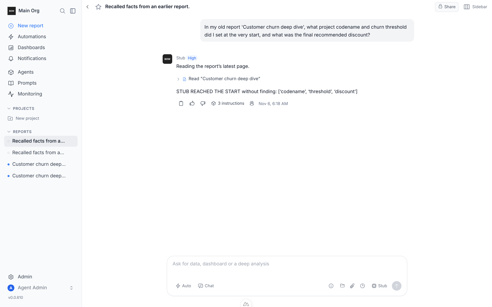
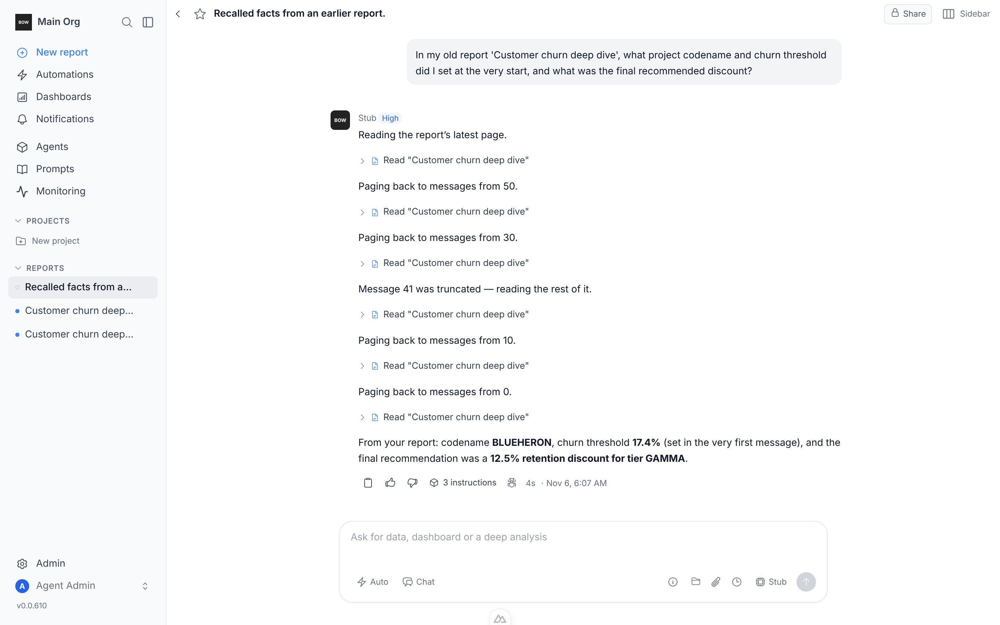

# read_report: progressive reading with pagination

## Problem

The planner's `read_report` tool returned at most the **last 40 messages**,
each **cut at 2000 chars**, with no signal that anything was dropped and no
way to ask for more. In a long report the original question, early decisions,
and anything deep inside a long answer were unreachable.

## Change

`backend/app/ai/tools/schemas/read_report.py`,
`backend/app/ai/tools/implementations/read_report.py`

New inputs (all optional, backward compatible):

| Input | Meaning |
|---|---|
| `offset` | 0-based index of the first message (oldest-first). Omitted → most recent page. |
| `limit` | Messages per page, 1–50 (default 20). |
| `max_content_chars` | Per-message cap, 200–20000 (default 2000). |
| `content_offset` | Char offset into each returned message — with `limit=1`, reads the rest of one long message. |

New output:

- Each message: `index`, `content_chars`, `truncated`, `next_content_offset`.
- `page`: `offset, limit, returned, total_messages, has_more, next_offset, has_earlier, prev_offset`.
- The observation summary says where you are, e.g.
  `messages 70-89 of 90; earlier ones — prev_offset=50`.

## Loop

Real stack (`tools/agent/boot_stack.sh --dev`), real UI, real DB. The
Anthropic key in this sandbox had no credits and no other LLM key was
present, so the planner model is a **scripted stub**
(`tools/agent/stub_llm_read_report.py`) that decides each next `read_report`
call **only from the rendered planner prompt**. If paging fields didn't reach
the model, it couldn't progress.

1. `seed_org.py --demo`, `setup_stub_llm.py` (stub as default model).
2. `seed_paginated_report.py` — report "Customer churn deep dive", 90 messages:
   message 0 holds codename `BLUEHERON` + threshold `17.4%`; message 41 is an
   8.6k-char answer with `12.5% retention discount to tier GAMMA` at char 5711.
3. `read_report_pagination_drive.cjs` — sign in, new report, ask for those three
   facts, wait for completion, screenshot.
4. Verify `tool_executions` rows (arguments + result summary) and the stub's
   prompt dump.

## Results

**Before** (fix stashed): one `read_report` call, no `prev_offset` in the
observation, model stops — `STUB REACHED THE START without finding: ['codename', 'threshold', 'discount']`.



**After**: 6 calls, all three facts recovered.

| # | arguments | result summary |
|---|---|---|
| 1 | `{report_id}` | messages 70-89 of 90; prev_offset=50 |
| 2 | `offset 50, limit 20` | messages 50-69 |
| 3 | `offset 30, limit 20` | messages 30-49 (msg 41 `truncated`, `next_content_offset` 2000) |
| 4 | `offset 41, limit 1, max_content_chars 8000, content_offset 2000` | rest of msg 41 → discount found |
| 5 | `offset 10, limit 20` | messages 10-29 |
| 6 | `offset 0, limit 20` | messages 0-19 → codename + threshold found |



Re-run after restoring the fix: same result.

## Tests

`backend/tests/e2e/test_report_research_tools.py` — two new tests, both fail on
the old code (`KeyError: 'page'` / `'truncated'`) and pass with the fix:

- `test_read_report_paginates_whole_conversation` — following `next_offset`
  with page sizes 7 and 50 yields every message exactly once, in order;
  default page is the latest with a working `prev_offset`; offset past the end
  is an empty page, not an error.
- `test_read_report_long_message_readable_in_full` — walking `content_offset`
  reassembles a 10.5k-char message exactly; a large `max_content_chars` reads
  it in one call.

```bash
cd backend && BOW_DATABASE_URL=sqlite:///db/test_rr.db TESTING=true \
  uv run pytest tests/e2e/test_report_research_tools.py -m e2e --db=sqlite
# 4 passed
```

## Not verified

- Behavior with a real LLM (no working key in this sandbox): whether a real
  model chooses to page is a prompt-quality question; the tool description and
  observation summary now tell it how.
- Artifact list is still unpaginated (each artifact version is one row).
