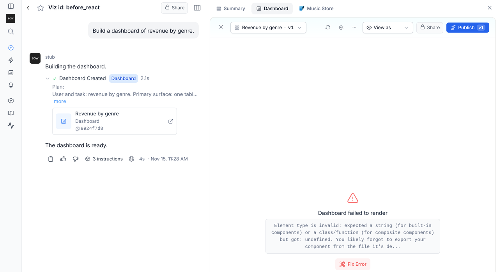
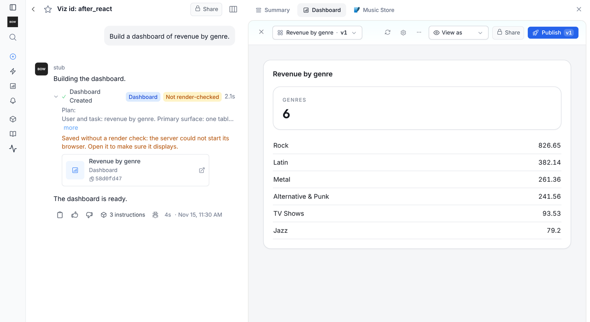

# Feedback Loop — "Dashboard Edited ✓" on a dashboard that fails to render

**Status: IMPLEMENTED and VERIFIED (2026-11-15).** Loop A passes on SQLite. Loop B ran the full
stack (real backend, Nuxt dev frontend, real browser) with a **scripted** model, and with the
server-side render browser deliberately unavailable (`BOW_CHROMIUM_EXECUTABLE=/nonexistent/chromium`).
A real model was not available in this sandbox, so the model's *reaction* to the new note is not
covered.

## What was reported

Three `edit_artifact` calls showed a green tick in about a second each, the model said the dashboard
"should now render as expected", and the panel showed

> Dashboard failed to render — Element type is invalid: expected a string … but got: undefined.

## Root cause (validated)

Two independent gaps.

1. **The page took runtime globals from `React`.** `const { useState, KPICard, SectionCard } = React;`
   declares `KPICard` as `React.KPICard`, which is `undefined`, shadowing the global component.
   Reproduced the exact message with this code; a component name that does not exist gives a
   different one ("X is not defined"). No static check covered it.
2. **No render ran, and nothing said so.** `CreateArtifactTool._take_preview_screenshot` swallows a
   browser launch failure and returns no errors, so the tools saved the page as a success. With a
   working browser the same code is refused as a fatal render error (10–15s here); with none the
   call returns in 0.4s — the reported edits took 0.8–1.9s.

## The change

| Piece | Where |
|---|---|
| Drop names React does not export from `const { … } = React` (the global is then used) | `backend/app/ai/tools/implementations/_artifact_refs.py` (`strip_non_react_destructures`), called from `create_artifact.py` and `edit_artifact.py` |
| `render_checked: false` on the tool output and observation when a page is saved unrendered; the observation tells the model not to claim it works | `create_artifact.py` (`RENDER_UNCHECKED_NOTE`), `edit_artifact.py`, output schemas |
| Launch failure logged at ERROR with the remedy | `create_artifact.py` (`_take_preview_screenshot`) |
| Amber "Not render-checked" badge and one-line note on the chat card | `frontend/components/tools/CreateArtifactTool.vue`, `EditArtifactTool.vue`, `locales/*.json` (`tools.createArtifact.notRenderChecked*`, `tools.editArtifact.notRenderChecked*`) |

The page is still saved when no browser is available: a deployment without one must keep working.

## Loop A — deterministic

```bash
cd backend
export BOW_DATABASE_URL="sqlite:///db/app.db" TESTING=true
uv run pytest tests/unit/test_artifact_react_destructure.py -q
uv run pytest tests/e2e/test_artifact_render_unchecked.py -m e2e --db=sqlite -q
```

Observed: `37 passed` (unit), `14 passed` (e2e). The first unit run failed one case — the pattern
matched `ReactDOM` as `React` — which is fixed.

Can it fail? With `backend/app` stashed, the e2e file gave `12 failed, 2 passed` (the two that
pass check that a page taking only real React exports is saved as written).

Real browser, same code before and after the codemod (`_take_preview_screenshot` directly):
before → fatal `Element type is invalid…`; after → no errors.

## Loop B — full stack, scripted model, no render browser

Boot as in `2026-11-15-viz-id-resolution.md`, but start the backend with
`BOW_CHROMIUM_EXECUTABLE=/nonexistent/chromium` and the stub with
`STUB_PAGE_FILE=$OUT/stub_page`, then:

```bash
bash docs/feedback-loops/2026-11-15-viz-id-resolution/run.sh $OUT after_react react
```

The `react` scenario makes the scripted model write a page with
`const { useState, useEffect, KPICard, SectionCard } = React;`.

| | Before | After |
|---|---|---|
| Chat card | green tick, "Dashboard Created" | "Dashboard Created" + amber "Not render-checked" + note |
| Tool summary | "Static render preview unavailable; interactions have not been checked." | "NOT RENDER-CHECKED: … Do NOT tell the user it works …" |
| Dashboard panel | "Dashboard failed to render — Element type is invalid…" | renders the KPI card and 6 rows |
| Backend log | one WARNING | one ERROR naming the remedy |

Before:



After:



## Not covered

- Hebrew/RTL capture of the badge (it uses logical margins only).
- The legacy generation paths (`edit_artifact_legacy.py`, MCP `edit_instruction`) are unchanged.
- The authoring guidance still says only "never destructure hooks from React".
