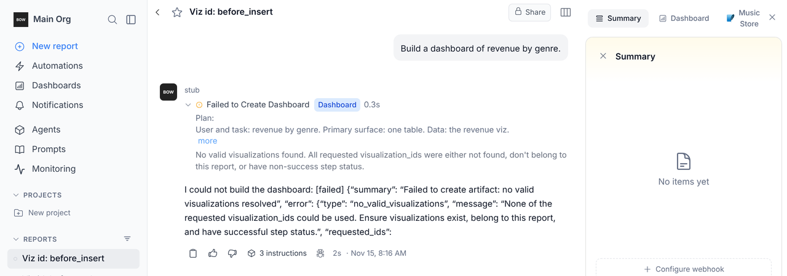
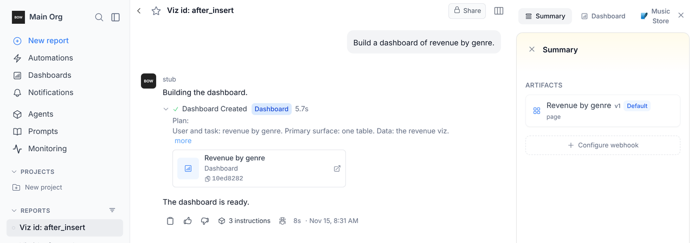
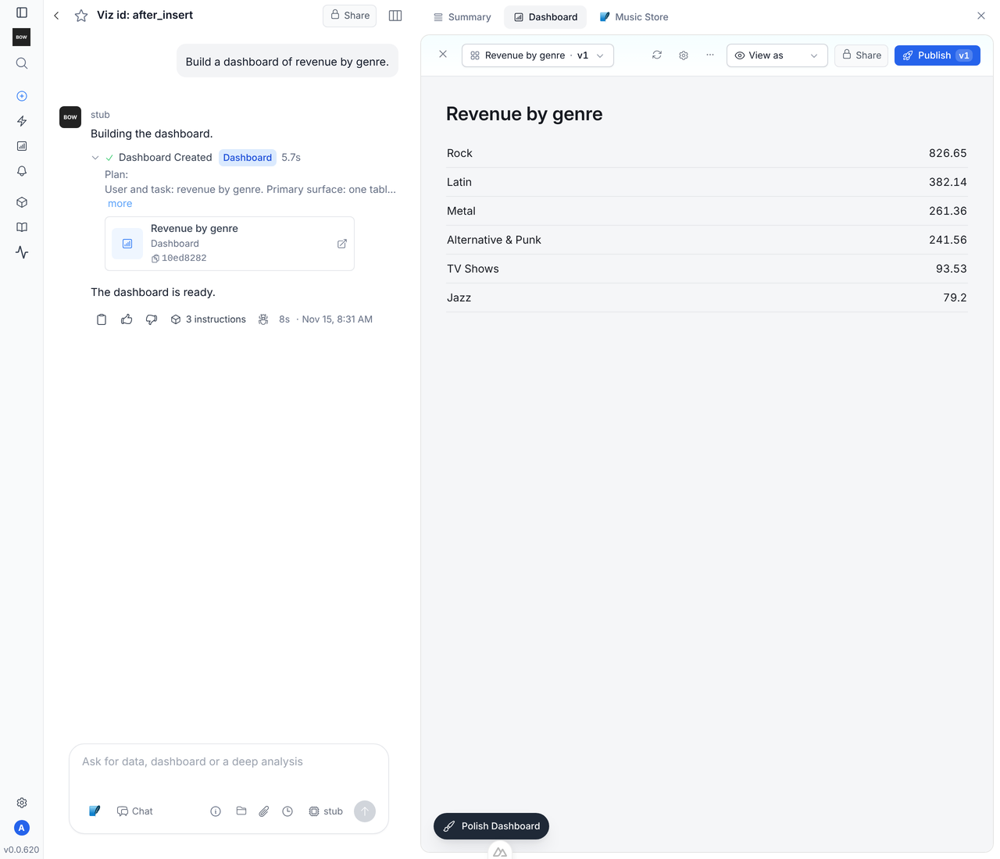
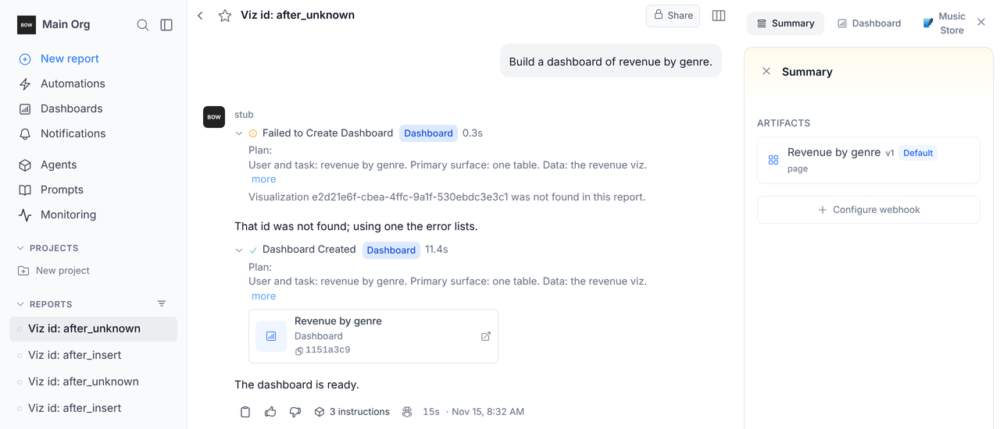

# Feedback Loop — a miscopied visualization id fails the whole dashboard

**Status: IMPLEMENTED and VERIFIED (2026-11-15).** Loop A passes on SQLite. Loop B ran the full
stack (real backend, Nuxt dev frontend, real browser, real render validation) with a **scripted**
OpenAI-compatible model. A real model was not possible in this sandbox (the Anthropic key had no
credit), and a real model does not miscopy an id on demand — the stub writes the wrong id
deterministically. The model's *choice* of id is therefore not covered here.

## What was reported

A weak model asked for a dashboard called `create_artifact` and failed in 0.2s with

> No valid visualizations found. All requested visualization_ids were either not found, don't
> belong to this report, or have non-success step status.

The id in its plan had one extra character (33 hex digits instead of 32). The model then rebuilt
the data from scratch instead of re-copying the id.

## Root cause (validated)

`create_artifact` compared the id as an exact string
(`backend/app/ai/tools/implementations/create_artifact.py`, the `fetched_vizs.get(viz_id)` lookup),
`visualization_ids` is an unvalidated `List[str]`, and the error named three possible causes and
none of the ids that would have worked. `edit_artifact`, `create_doc` / `edit_doc` and `read_query`
looked ids up the same way.

## The change

| Piece | Where |
|---|---|
| One resolver: canonical spelling → near miss within THIS report → per-id reason + usable ids | `backend/app/ai/tools/implementations/_viz_ids.py` |
| `create_artifact`: resolve ids, correct the same slip in the authored code, specific error with `available_visualizations` | `backend/app/ai/tools/implementations/create_artifact.py` |
| `edit_artifact`: resolve added and removed ids; an added id that names nothing is refused (was saved as a dead id) | `backend/app/ai/tools/implementations/edit_artifact.py`, `backend/app/ai/tools/mcp/edit_artifact.py` |
| `create_doc` / `edit_doc`: repair `{{viz:<id>}}` placeholders in the markdown | `create_doc.py`, `edit_doc.py`, `_doc_markdown.py` |
| `read_query`: resolve the id; a miss lists the report's visualizations | `read_query.py` |

A near miss is at most 2 single-character edits from exactly one visualization of the same report,
or a cut-off id (8+ characters) that starts exactly one. Two candidates → no guess. Another
report's visualization is never a candidate.

## Loop A — deterministic (no external services)

```bash
cd backend
export BOW_DATABASE_URL="sqlite:///db/app.db" TESTING=true
uv run pytest tests/unit/test_viz_id_resolution.py -q
uv run pytest tests/e2e/test_visualization_id_resolution.py tests/e2e/test_doc_artifacts.py -m e2e --db=sqlite -q
```

Observed: `145 passed` (unit), `45 passed` (e2e: 32 new + the existing doc tests).

Can it fail? With the tool changes stashed (resolver file kept), the new e2e file gave
`27 failed, 1 passed` — the one pass was the cross-report check, which the old exact match already
satisfied.

## Loop B — full stack, scripted model, real UI

```bash
BOW_ENCRYPTION_KEY=<stable fernet key> BOW_CHROMIUM_EXECUTABLE=/opt/pw-browsers/chromium \
  tools/agent/boot_stack.sh --dev
cd backend && uv run python ../tools/agent/seed_org.py --demo
OUT=<scratch dir>; mkdir -p $OUT
STUB_VIZ_ID=unset STUB_VIZ_ID_FILE=$OUT/stub_viz_id \
  uv run python ../docs/feedback-loops/2026-11-15-viz-id-resolution/stub_llm.py &
uv run python ../docs/feedback-loops/2026-11-15-viz-id-resolution/setup.py > $OUT/setup.json
cd .. && bash docs/feedback-loops/2026-11-15-viz-id-resolution/run.sh $OUT after_insert insert
bash docs/feedback-loops/2026-11-15-viz-id-resolution/run.sh $OUT after_unknown unknown
```

`run.sh` creates a report, seeds one finished visualization (`seed_viz.py`), tells the stub which
id to write, sends "Build a dashboard of revenue by genre." through the chat UI (`drive.mjs`), and
prints what each `create_artifact` call returned and what was saved.

| Scenario | Before | After |
|---|---|---|
| `insert` — one character inserted into the real id | `create_artifact: error`, no artifact, the three-cause message | `create_artifact: success`; saved `visualization_ids` = the real id; code binds the real id; the dashboard renders the 6 rows |
| `unknown` — an id that names nothing | `create_artifact: error`, no artifact; the stub has nothing to retry with | first call `error` ("Visualization … was not found in this report."), the stub copies an id from `available_visualizations`, second call `success`; dashboard renders |

Before (the reported failure, reproduced):



After, same miscopied id:




After, an id that names nothing — specific error, then recovery:



## Notes from the loop

- The stub's first page code had no `ReactDOM.createRoot(...).render(<App />)` line. Render
  validation still reported "passed" and the saved dashboard stayed on "Loading artifact…" in the
  browser. That is a gap in render validation, unrelated to ids; not changed here.
- `run_query` and `add_parameter` accept either a query id or a visualization id and still match
  exactly; not changed here.
