# Feedback loop — public agents hide member permission management

An agent manager must be able to assign query, management, or custom access to
users and groups regardless of whether the agent is public within the organization.
Adding and editing use the same two simple roles, with granular permissions
under a collapsed **Advanced permissions** control.

## Root cause (validated)

On base `86150bc6e`, `frontend/components/AgentSettingsPanel.vue:88` required
`!form.isPublic` to show Add member, and line 98 wrapped the entire explicit
member list in the same condition. Enabling public access hid the only controls
for changing management rights. Private member rows exposed raw grant labels,
including `manage` as “Manage settings”, while the add dialog used Can query /
Can manage.

The backend already supports the intended model:

- `backend/app/routes/data_source.py:483`: member listing requires view;
  membership mutations require manage and do not reject public agents.
- `backend/app/routes/rbac.py`: grant mutations require management authority
  over the resource (or full organization admin authority).
- `backend/app/core/permissions_decorator.py`: public fallback only permits
  view/view_schema; management still requires explicit authority.

The current main branch already includes principal-aware removal of both grant
and legacy membership. No backend implementation change or migration is needed.

## Loop A — local stack, seeded data, no external services

In a fresh sandbox with dependencies installed, use the repo stack helper:

```bash
tools/agent/boot_stack.sh --dev
backend/.venv/bin/python tools/agent/seed_org.py \
  --sqlite-sources 1 \
  --invite analyst@example.com \
  --invite manager@example.com \
  --invite reader@example.com > /tmp/agent-access-seed.json
chmod 600 /tmp/agent-access-seed.json
cd frontend
BASE_URL=http://localhost:3000 \
BOW_ACCESS_SEED=/tmp/agent-access-seed.json \
node tests/access/agent-member-access.mjs
```

The seed summary contains throwaway authentication tokens; keep it outside the
repository. The test uses its `base_url`, organization, and first SQLite agent,
resets explicit test memberships, and exercises the real membership/grant APIs.
Only the failed-save case intercepts a request, returning a deterministic 500.
Run this only against the disposable seeded organization.

To reproduce on the base UI while retaining the regression script, temporarily
replace only `frontend/components/AgentSettingsPanel.vue` with the version from
`86150bc6e`, then restore the working version and rerun the same command. The
first assertion fails because public agents have no Add member button.

Observed baseline in the browser: **public Add member count = 0**. Explicit
member rows disappeared when public access was enabled. After the fix, the
same public agent exposes Add member and all explicit member rows.

This verification used isolated services on frontend `3107` / backend `8107`,
with a freshly migrated SQLite database outside the repository, because the
primary checkout already had a running stack and uncommitted work.

## The fix

- Always show explicit members; public agents have a separate organization-wide
  Can query baseline row.
- Member rows show Can query, Can manage, or Custom access. Owners display their
  effective Can manage authority without an ineffective grant editor.
- Both add and edit use the same dialog. Advanced remains collapsed, and custom
  grants are copied unchanged into the draft until the user saves a change.
- Removing an explicit member explains that public/group/org access may remain.
- Failed edits retain the saved role and open editor. Partial add/permission
  failures no longer report complete success. Principal matching includes type.
- New copy is present in all ten locale catalogs; existing localized role-editor
  permission labels are reused in Advanced.

## Observed verification

The real-stack browser regression passed all nine scenarios:

1. Public-agent query → manage saves through the real API.
2. Custom permissions survive save/reload; Advanced starts collapsed.
3. A failed permission save preserves the existing role and editor.
4. A manager can be added to a public agent.
5. Partial add failures report incomplete access and can be corrected.
6. Public/private toggles retain grants; removal deletes explicit membership.
7. Hebrew RTL list and editor render correctly, including a narrow dialog.
8. A non-admin agent manager can edit public-agent permissions.
9. A public reader sees roles without management controls; grant mutation is 403.

No browser page errors were observed. The existing locale sweep also passed:

```bash
cd frontend
PLAYWRIGHT_BASE_URL=http://localhost:3107 \
npx playwright test --config=playwright.i18n.config.ts --workers=1
# 30 passed
```

Catalog key comparison against `main` confirms no increase in existing drift.
Vue SFC script/template compilation and `git diff --check` also passed.

## UI evidence

Screenshots use seeded data at the same 1280 × 1000 viewport. The narrow Hebrew
editor uses 390 × 844. The surrounding settings page still contains pre-existing
English strings; this change localizes the access editor and its new copy.

| State | Before | After |
| --- | --- | --- |
| Public permissions | 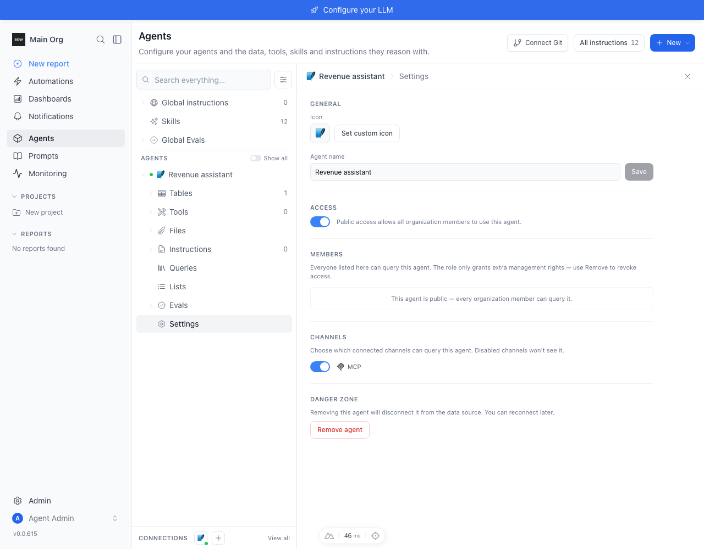 | 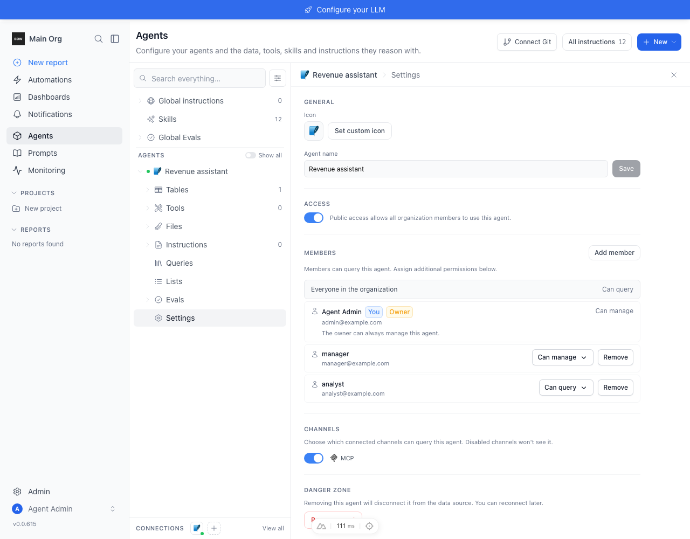 |
| Private member roles | 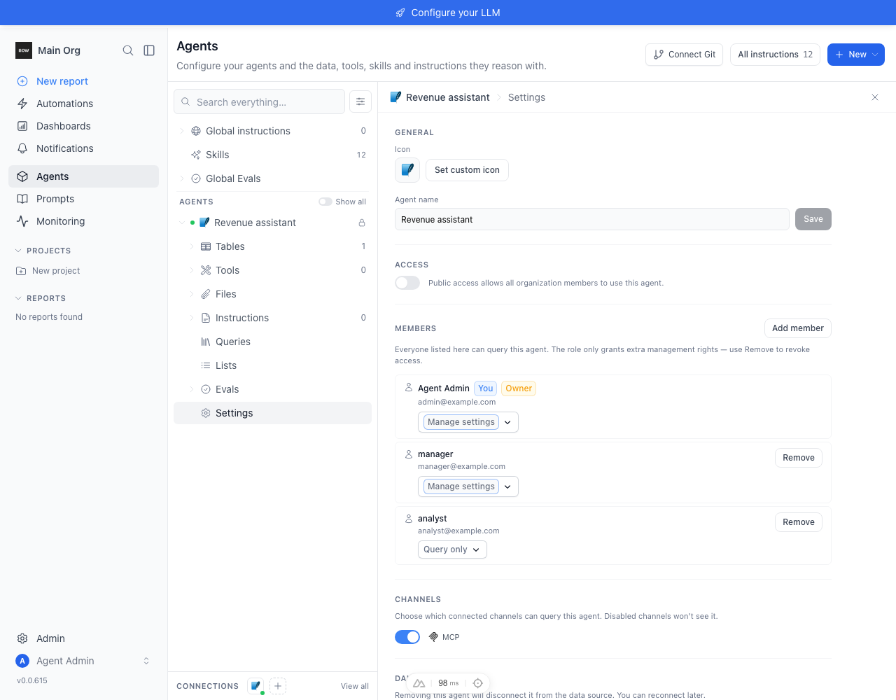 | 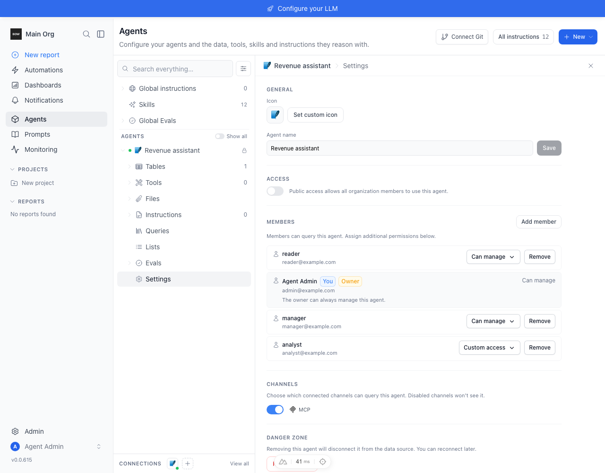 |
| Add member | 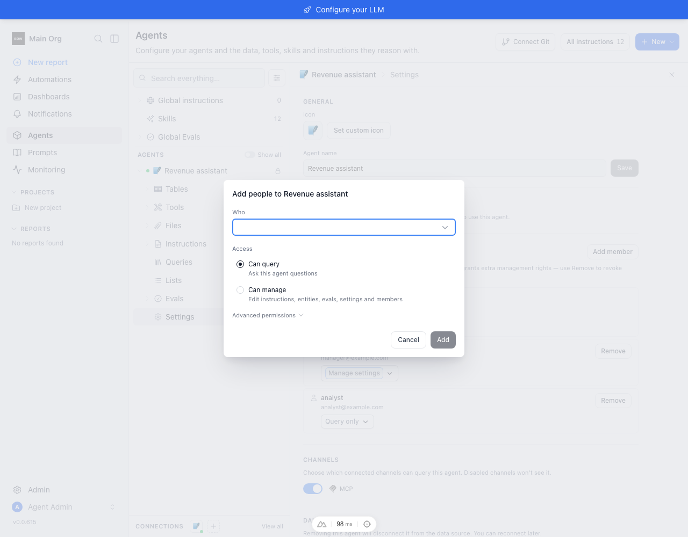 | 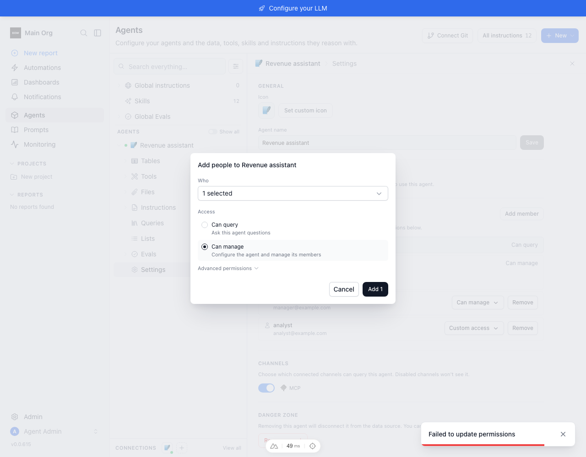 |
| Hebrew public permissions | 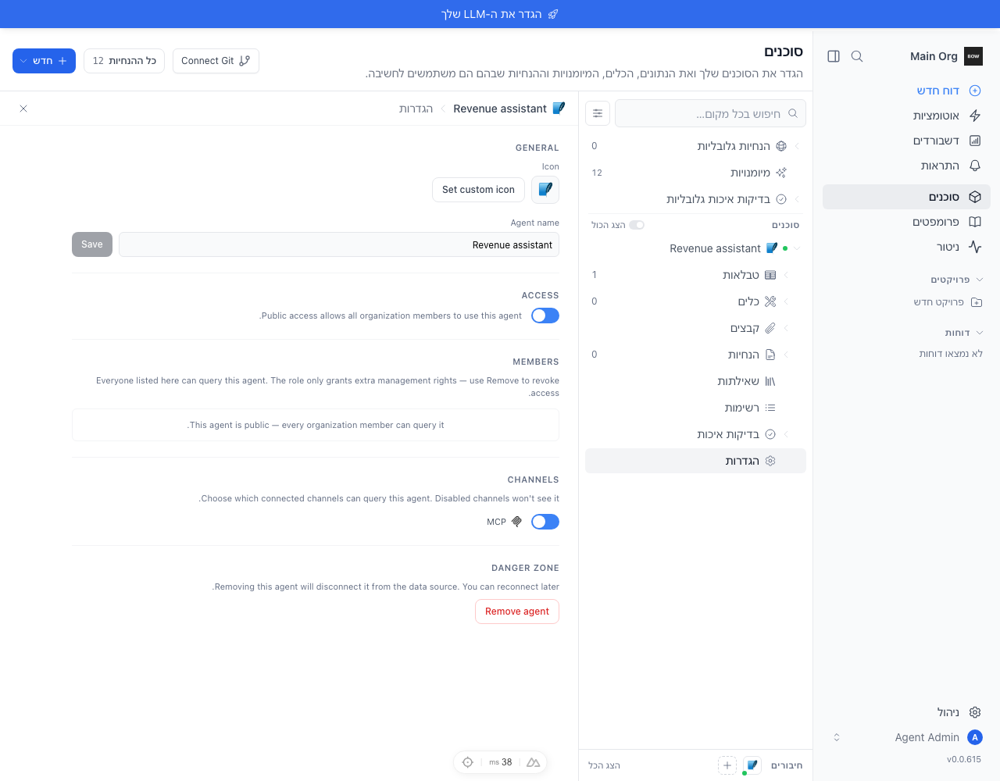 | 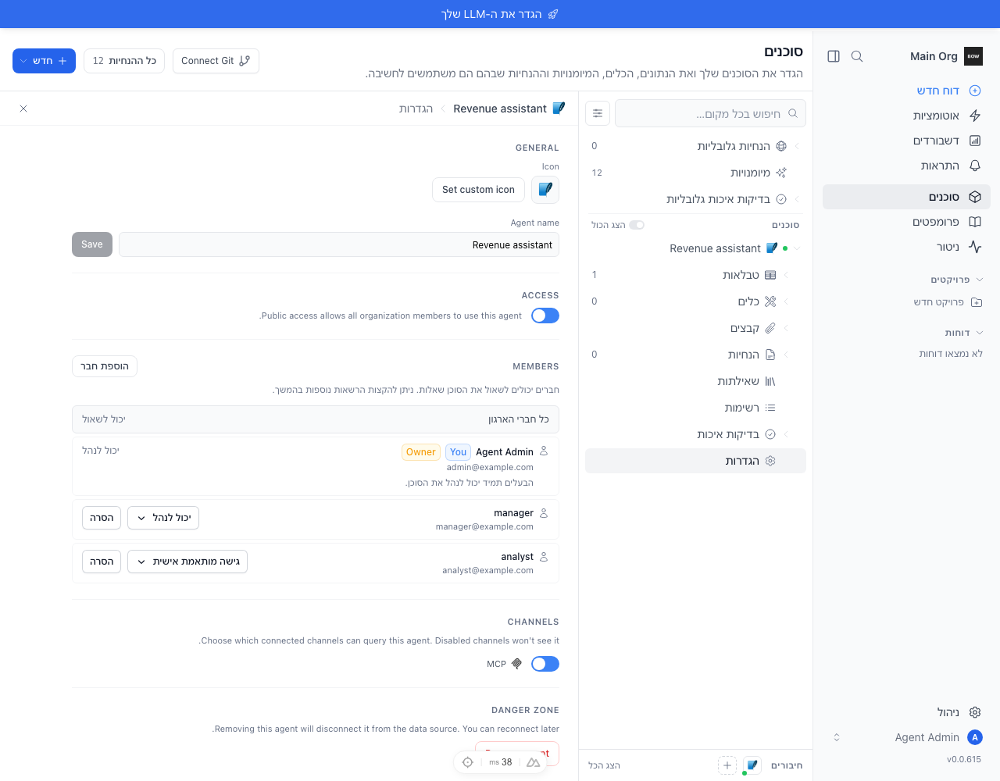 |

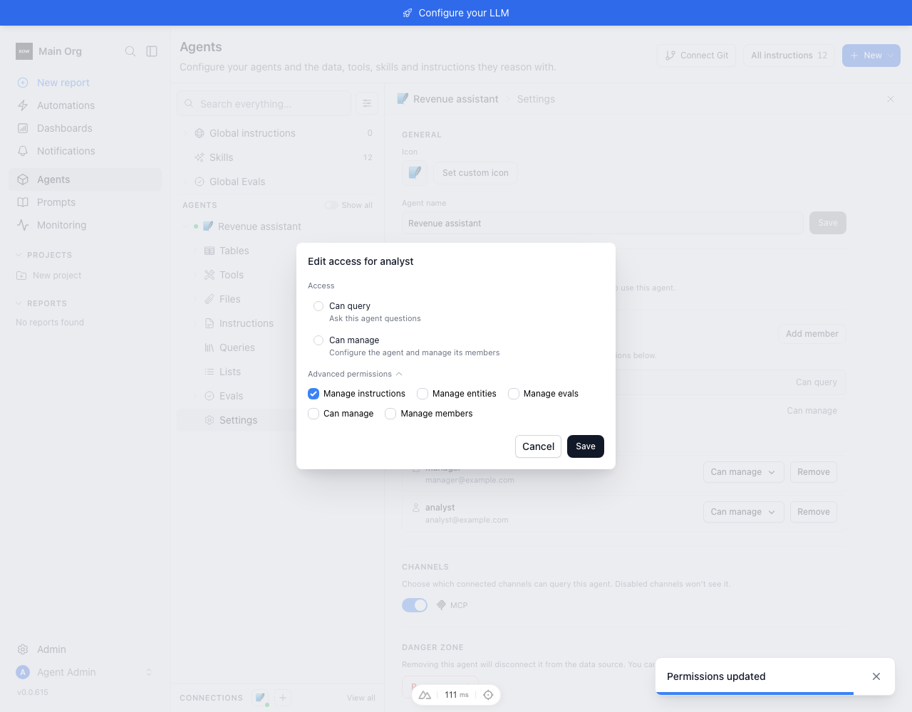
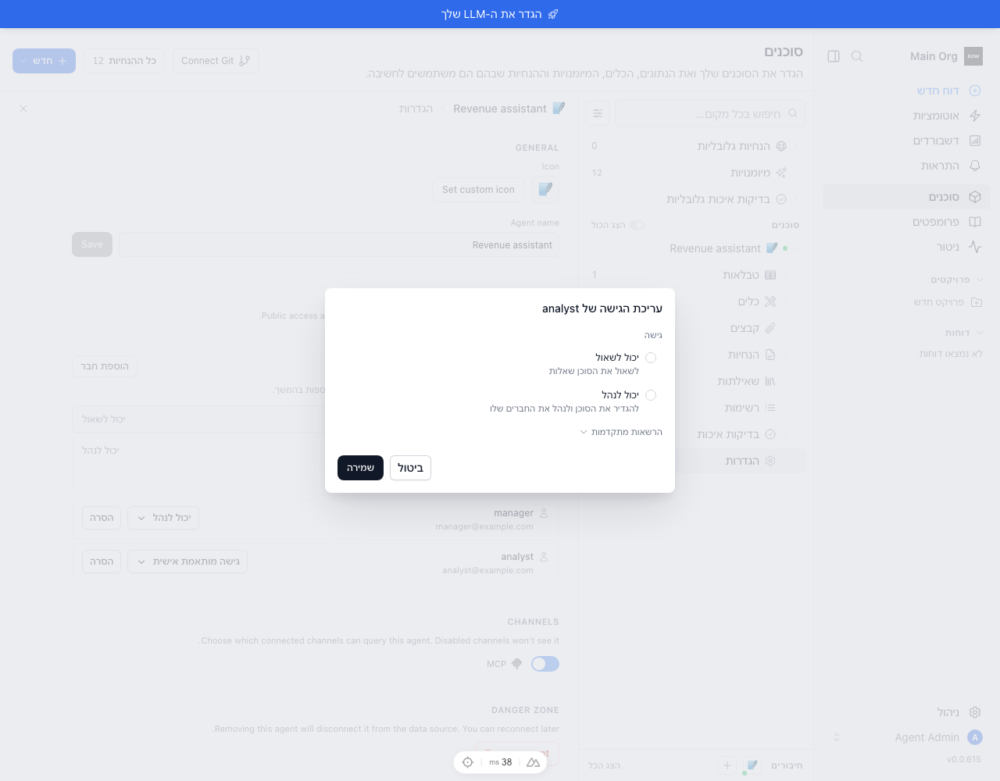
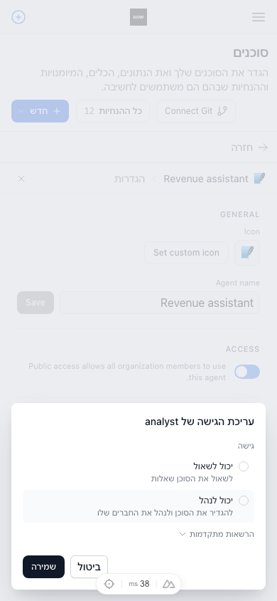
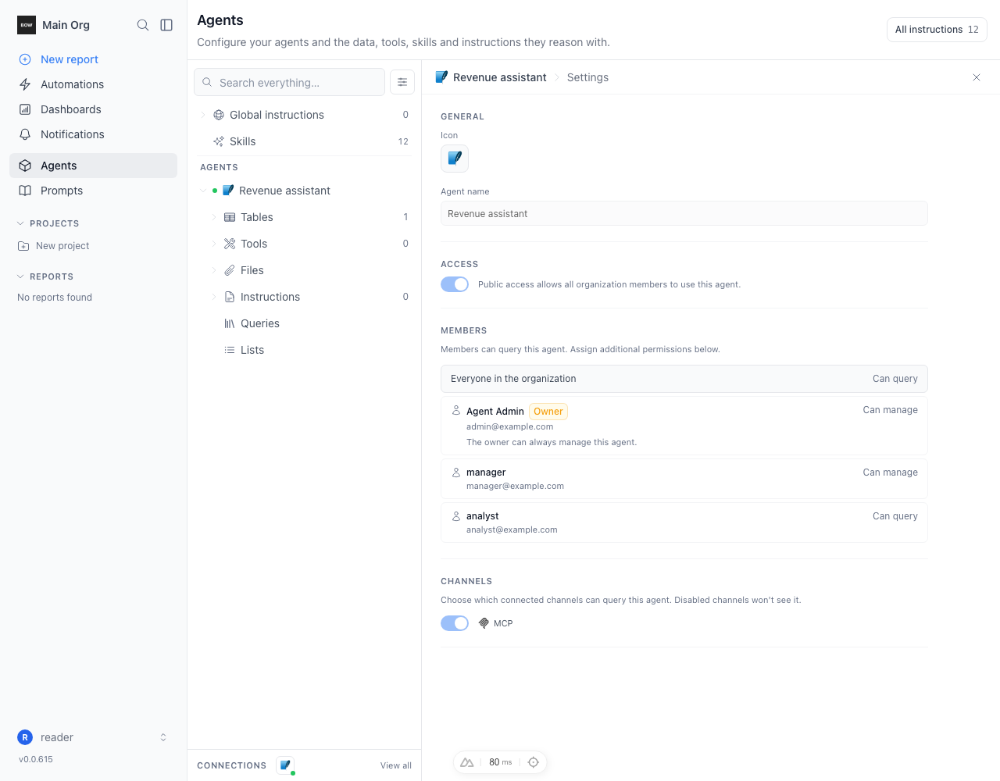


## Scope and regression notes

Backend policy and schemas are unchanged. This pass uses a community license and
real user grants. Enterprise group/role creation was not live-tested; existing
typed-principal rendering and removal paths are retained. The two-request add
flow remains non-atomic, but reports partial failure accurately. No customer data,
external data source credentials, or LLM calls are needed for this loop.
