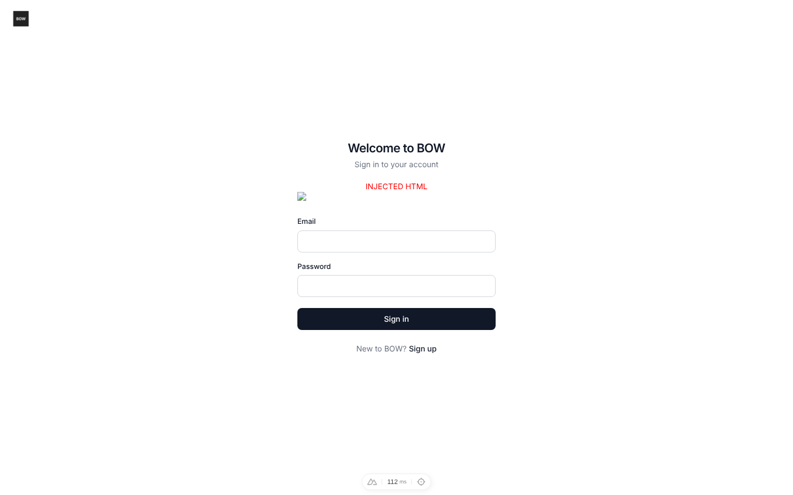
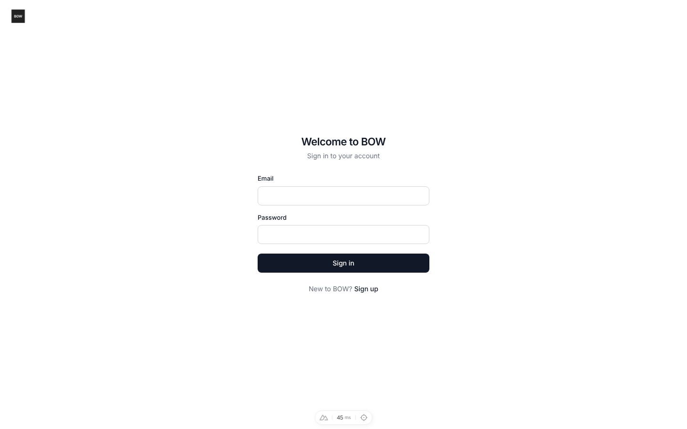
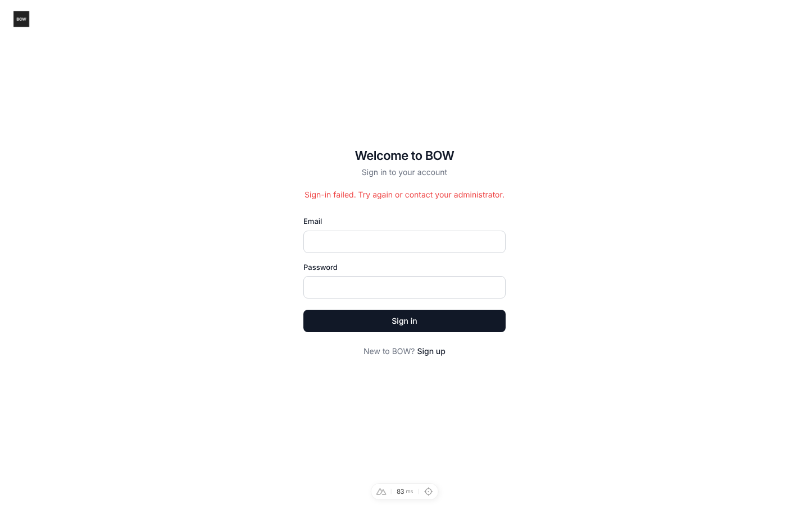

# Feedback Loop — "Reflected XSS in OAuth callback error handling" / "Reflected XSS in /users/sign-up via unsanitized error query parameter"

Security audit reported two reflected-XSS findings: the OAuth callback
(`/api/auth/{provider}/callback`) and `/users/sign-up`. Claim validated: both are
one bug — the auth pages render the `?error=` query param with `v-html`, and the
callback copies the provider's `error_description` into that param.

## Root cause (validated)

- **Sink:** `frontend/pages/users/sign-in.vue:11` and `frontend/pages/users/sign-up.vue:11`
  rendered `error_message` with `v-html`; both set it from `route.query.error`.
- **Delivery:** `backend/app/services/auth_providers.py` `handle_callback` redirected
  to `/users/sign-in?error=<error_description>`. That branch runs **before any
  state check**, so anyone can craft
  `/api/auth/google/callback?error=x&error_description=`
  on the real domain. Exception messages (e.g. `Token exchange failed: {body}`)
  were reflected the same way.
- Validated in a browser: `window.__xss` set by the payload on both pages and via the callback chain.

## Loop A — deterministic reproduction (no external services)

Stack: `tools/agent/boot_stack.sh --dev`, then
`cd backend && uv run python ../tools/agent/seed_org.py` (so sign-in doesn't redirect to first-run setup).

Browser (Playwright, logged-out):

```bash
cd frontend
# In CI this spec runs inside the `features` project. Locally, against an
# already-seeded stack, skip the global admin-signup setup with a one-file config:
cat > pw.xss.local.config.ts <<'CFG'   # must live in frontend/ to resolve @playwright/test
import { defineConfig } from '@playwright/test'
export default defineConfig({ testDir: './tests/auth', testMatch: 'auth-error-xss.spec.ts',
  use: { headless: true, baseURL: 'http://localhost:3000' } })
CFG
PLAYWRIGHT_BROWSERS_PATH=/opt/pw-browsers npx playwright test -c pw.xss.local.config.ts; rm pw.xss.local.config.ts
```

Backend (no stack needed):

```bash
cd backend && TESTING=true uv run pytest tests/e2e/test_oauth_callback_error_redirect.py -m e2e --db=sqlite
```

Observed on the original code:

```
$ curl -si ".../api/auth/google/callback?error=access_denied&error_description="
location: /users/sign-in?error=%3Cimg%20src%3Dx%20onerror%3Dalert%281%29%3E

Playwright: 3 failed   (Received: 1  — window.__xss was set on sign-in, sign-up, and via the callback)
pytest:     9 failed
```



## The fix

- `auth_providers.py`: `_error_redirect` now only emits `?error_code=` from a closed set
  (`invitation_required`, `oauth_email_missing`, `oauth_login_failed`); provider text stays in the server log.
- `sign-in.vue`: maps known `error_code`s to `errors.*` locale strings, ignores unknown codes,
  no longer reads `?error=`; `sign-up.vue` no longer reads `?error=`. Both render with `{{ }}`, not `v-html`.
- `locales/*.json`: 3 new `errors.*` keys in all 10 catalogs.
- `components/dashboard/text/TextWidget.vue`: legacy `text_widget` content now goes through `DOMPurify.sanitize`
  (same pattern as `DocViewer.vue`).

Same loop after the fix:

```
location: /users/sign-in?error_code=oauth_login_failed
Playwright: 4 passed   (incl. "known error_code shows its localized message; unknown codes show nothing")
pytest:     9 passed
```

| After: payload in `?error=` | After: `?error_code=oauth_login_failed` |
|---|---|
|  |  |

## What this proves / regression notes

- Neither the URL nor the page can carry attacker text any more; the tests vary payloads
  (HTML, script-breakout, plain phishing text) and providers, and assert the invariant
  "redirect carries only an allow-listed `error_code`".
- Related suites still pass: `tests/unit/test_sso_login_hint.py`, `tests/e2e/test_login_exchange_code.py`, `tests/e2e/test_oauth_app.py`.
- Not covered: the separate "auth token cookie missing HttpOnly" finding — `auth_token` is written
  by nuxt-auth in JS and sent as a Bearer header, so HttpOnly needs a backend-owned cookie + CSRF (follow-up).
