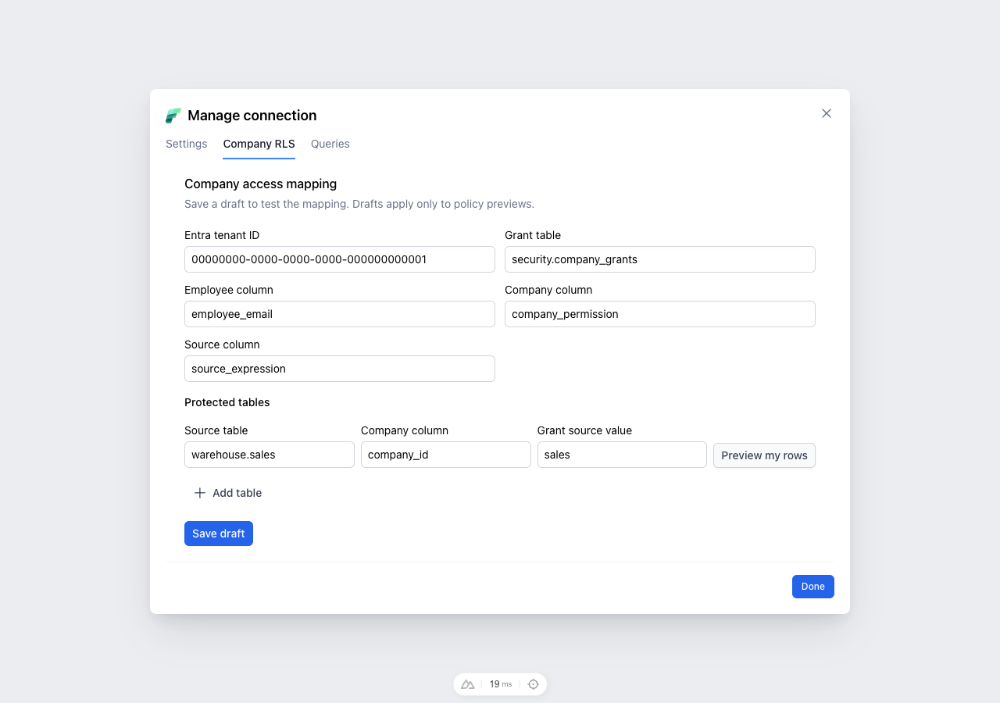
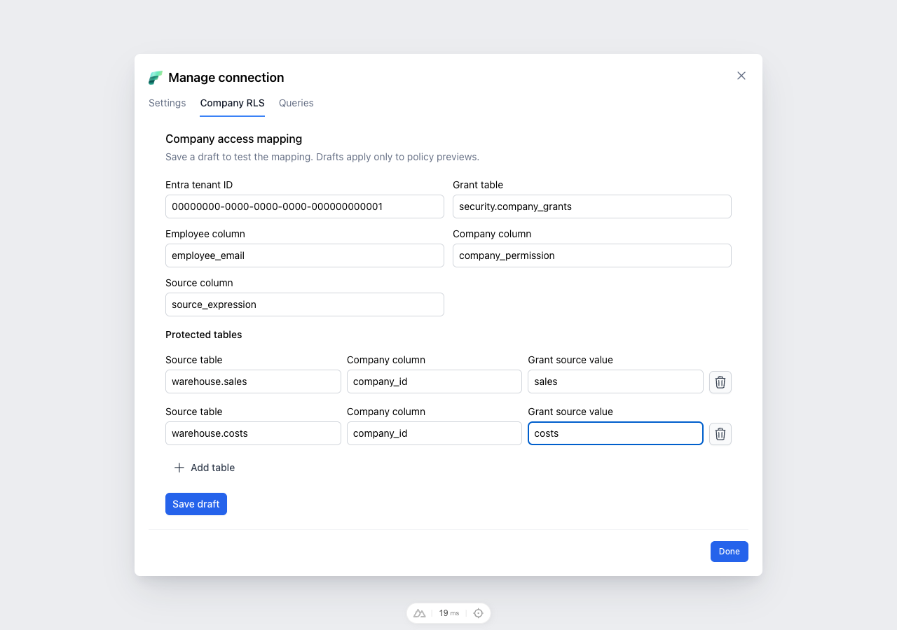

# Company filtering on a shared Fabric connection

For current connection configuration, CLS and multi-database checks, see [Enterprise connection access rules](enterprise-sql-access.md).


Two signed-in BOW readers use the same Warehouse credential. Each reader must receive only the companies their employee identity can access for the specific source table. A committed grant removal must take effect on their next read, including a previously opened shared report.

## Why the existing controls were insufficient

At the head of [#1741](https://github.com/bagofwords1/bagofwords/pull/1741), the executor could limit which tables a generated query read. Both readers in this fixture need the same sales table. Reading the unprotected sales and costs tables directly with the service account returned both companies, summing to 100 on each table. Checking the table name therefore cannot establish company isolation. Published outputs add a second boundary because stored rows or text can be returned without executing SQL.

## Loop A — local regression

From a prepared checkout, run the following with the backend test environment. The tests use local fixtures and the dashboard HTTP routes.

```sh
cd backend
TESTING=true BOW_DATABASE_URL=sqlite:///db/app.db .venv/bin/python -m pytest -q \
  tests/unit/test_fabric_company_rls.py \
  tests/e2e/dashboards/test_dashboard_data.py
```

Before the change, the new unit contract failed to collect because the policy compiler did not exist. The regression tests exercise source-specific grants, duplicate grants, CTE and union parameter ordering, policy refusal, revocation and withheld historical dashboard content. The expanded run across the related execution, dashboard, identity and notification suites passed 3,271 tests with one opt-in integration test skipped.

## Define the mapping

In a Fabric connection, open **Company RLS**. Enter the Entra tenant that issued the reader identity, the schema-qualified entitlement table and the employee, company and source columns in that table. For each protected fact table, enter its schema-qualified name, company key and exact source value from the entitlement rows. Save the draft, then select **Preview my rows** beside a saved rule. The preview uses the signed-in administrator's verified identity.





The screenshots use a synthetic tenant and a licensed component fixture displaying a saved draft from the local API. Saving a draft does not activate a connection policy. The live exercise activated the saved mapping through the API in an isolated BOW database.

[View the setup sequence](../../media/pr/fabric-company-rls/define-policy.gif).

## Loop B — signed-in readers and a live Warehouse

Use the unprotected sales and costs fixtures in demo_db with a shared service credential. In an isolated BOW organization, attach them to a system-credential Fabric connection, configure a disposable copy of the entitlement table, and save a draft. In the isolated deployment enable `features.fabric_company_rls_activation`, then send the exact saved mapping as the JSON body of `POST /api/connections/{id}/company-policy/activate` as a permitted administrator. The endpoint validates the viewer identity and Warehouse catalog, and commits the active policy and workspace hold together. An ordinary member received 403, a changed draft received 409, and activation returned 204. We disabled the activation switch again before querying. Prepare a saved sales query and a published shared dashboard referencing it. Include the sentinel OLD_PRIVATE_CAPTION in the stored chart. Sign both readers in through Entra token exchange and give them the connection permissions needed for the table-browser assertions.

| Read from BOW | Demo1 | Demo2 |
|---|---|---|
| Sales preview, saved query and published sales table | Company 101, amount 10 | Company 202, amount 90 |
| Costs preview | Company 202, amount 90 | Empty |
| Sales after committing removal of Demo1's sales grant | Empty in the existing session | Company 202, amount 90 |
| Costs after the same removal | Company 202, amount 90 | Empty |

The live run checked the builder and viewer query paths, the code and table previews and the published HTTP response. A raw content request was denied, the stored caption was absent, and anonymous access was denied. Restoring the grant restored Demo1's sales. The temporary entitlement table was removed afterward. Claude Haiku 5.5 generated a SELECT requesting company 202. The same SQL ran through each reader’s authenticated BOW code preview against the live Warehouse. Demo1 received zero rows and Demo2 received the company 202 sale for 90.

A browser opened the published link as an ordinary shared-report member and displayed only company 202. After the committed revocation, Demo1 opened the same report and saw an empty table. [Member view](../../media/pr/fabric-company-rls/member-report.png) · [Revoked view](../../media/pr/fabric-company-rls/revoked-report.png).

For a prepared sandbox, export BOW_RLS_BASE_URL (origin), BOW_RLS_ORG, BOW_RLS_CONNECTION, BOW_RLS_QUERY, BOW_RLS_DASHBOARD, BOW_RLS_SALES_TABLE and BOW_RLS_COSTS_TABLE (BOW IDs), plus the short-lived BOW_RLS_DEMO1_TOKEN and BOW_RLS_DEMO2_TOKEN in the process environment. Run the following from backend:

```sh
BOW_COMPANY_RLS_LIVE=1 .venv/bin/python -m pytest -q tests/integrations/test_fabric_company_rls_live.py
```

Commit removal of only Demo1's sales/101 row from the disposable grant table. Rerun with BOW_RLS_REVOKED=1 in the same sessions. Restore the row, rerun the initial check, and dispose of the copy. The committed integration test is read-only and requires the caller to prepare the fixture and make those two changes.

To repeat the Claude check, set BOW_COMPANY_RLS_CLAUDE=1, ANTHROPIC_API_KEY, BOW_RLS_CLAUDE_MODEL, BOW_RLS_DATA_SOURCE_NAME, and BOW_RLS_DEMO1_OWN_QUERY and BOW_RLS_DEMO2_OWN_QUERY (a personal editable query for each viewer). Run the same integration test module. Only the synthetic schema and request for company 202 go to the model.

## Enforcement and release status

The [compiler](../../backend/app/data_sources/fabric_company_rls.py) inserts a bound employee/source entitlement check at each protected physical table. The [Fabric client](../../backend/app/data_sources/clients/ms_fabric_client.py) sends the rewritten statement and its positional bindings to the Warehouse. The [preview service](../../backend/app/services/table_preview_service.py) queries through the bound client. The [published dashboard reader](../../backend/app/services/dashboard_runs.py) builds a fresh data-only response from supported projections for the authenticated reader. Older material from a known protected source is withheld when the service cannot regenerate it.

The approved rollout policy withholds historical report content across the workspace until BOW can verify its source. A durable workspace flag survives removal of the original connection. The regression detaches a published release from its source and exercises the owner and member reads, stored HTML and PDF exports and slide previews. A separate delivery test uses an attachment builder and a mail transport that fail the test if called. The live Warehouse acceptance was repeated with the workspace hold enabled, including the published dashboard and grant revocation. The expanded regression run passed 5,256 tests with one skipped. A separate context, memory and thumbnail run passed 61 tests.

Two full BOW chat requests reached Claude Haiku 5.5 and returned each signed-in viewer’s own company from the live Warehouse. That run also revealed that chat used a different step writer from the saved query editor. The writer now omits stored rows when the workspace hold applies, and a database regression checks the persisted step. A second regression injects a marker in catalog metadata and confirms that only protected table and column names and types reach the schema prompt.

The final live run removed the first viewer’s sales grant and continued the same Claude conversation. The next answer reported no sales, the second viewer retained their sale, and neither chat stored result rows in its query step. Both users also opened the same published dashboard under their own sessions. The test used real Entra authentication, Fabric and Claude, with the enterprise feature entitlement enabled through a local test stub. Production activation defaults to off. The live run did not measure large-warehouse performance, in-flight query cancellation, customer crawler propagation time or delivery through an external email provider.

The final combined local regression run passed 5,387 tests with 10 skips. A separate disposable SQLite check exercised the conditional activation write and verified both the active mapping and the workspace hold after reloading from the database.
