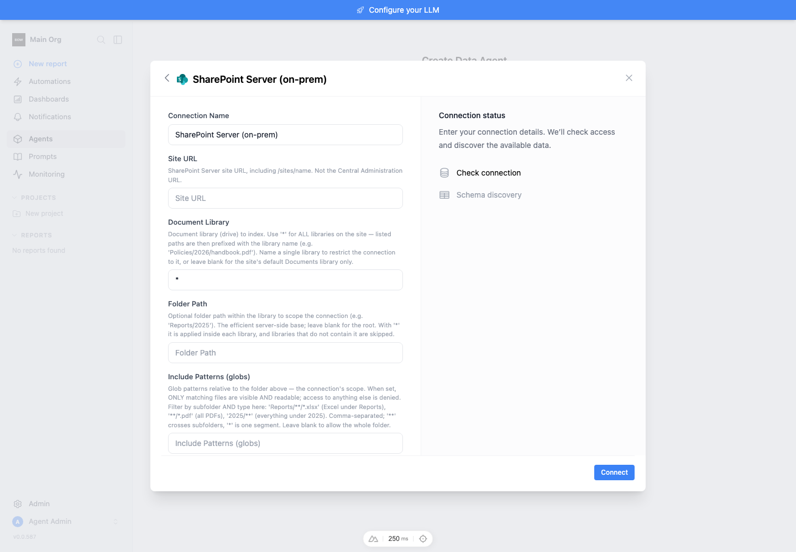
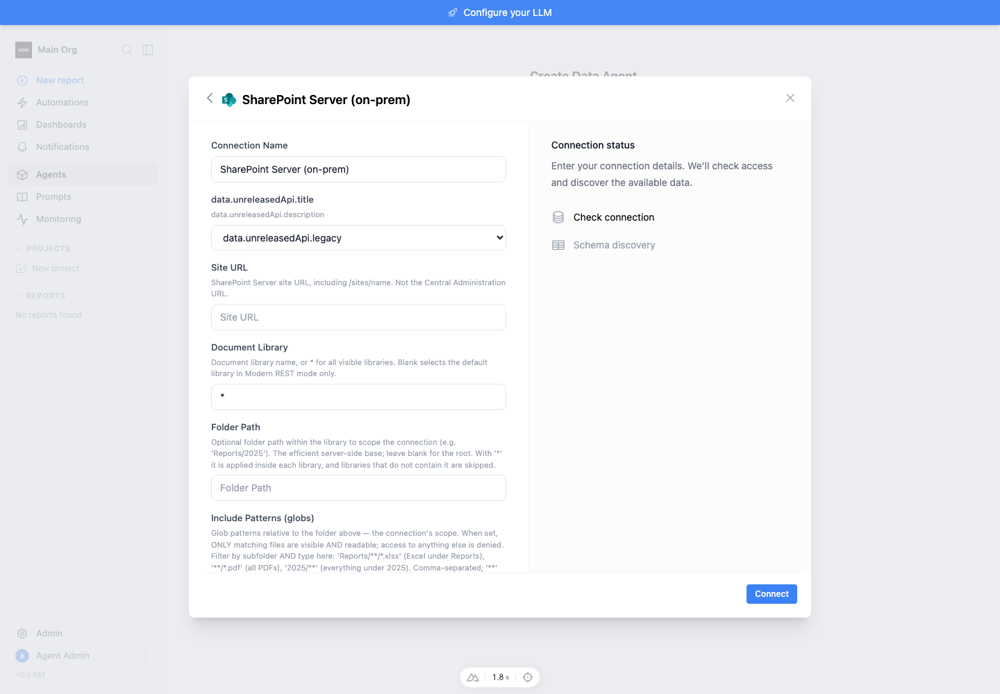
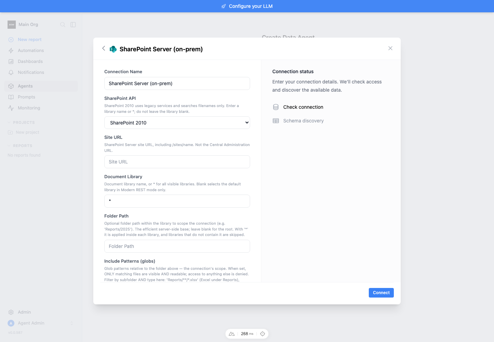
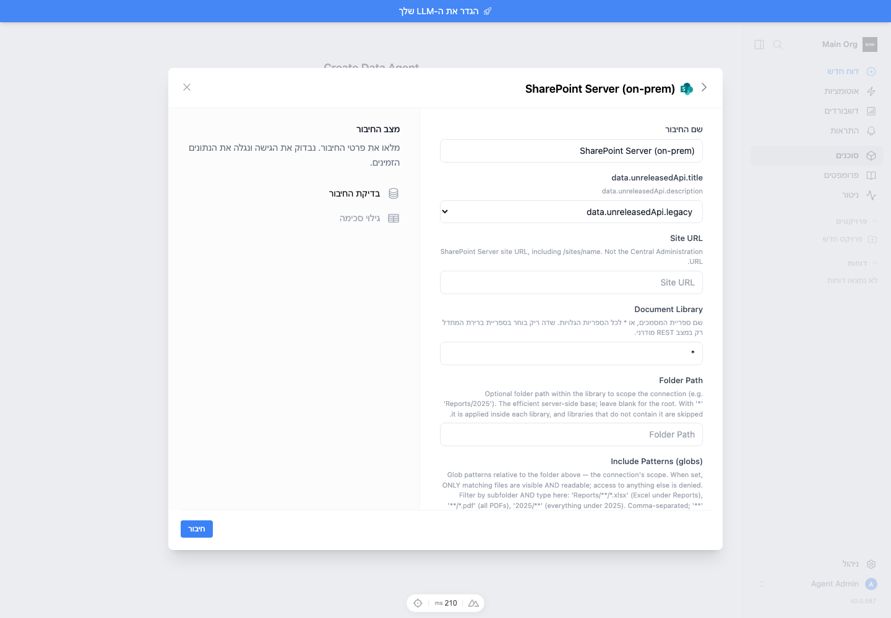
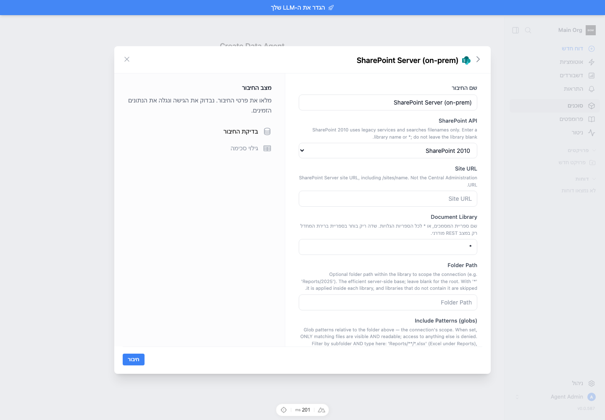

# Feedback Loop — SharePoint Server HTTP 404 on a SharePoint 2010 farm

The existing connector called modern REST endpoints on a reported SharePoint
2010 deployment. This change adds an explicit legacy protocol mode while keeping
the connector type, file metadata contract, and Windows authentication. The
screenshot alone cannot prove whether the customer's site/library path is also
wrong. The API mismatch is reproduced independently; real farm verification will
be run on-prem by the deployment owner.

## Root cause (validated)

At base commit `caf4c58da`,
`backend/app/data_sources/clients/sharepoint_onprem_client.py:92` constructs the
`/_api/` base unconditionally. Connection checking and file operations use modern
REST/ResourcePath calls. A simulated 2010 server that exposes the documented SOAP
services and returns 404 for modern REST reproduces the failed connection.

The new `api_mode` defaults to `modern` for backward compatibility; `2010` routes
through `backend/app/data_sources/clients/_sharepoint_2010.py`. It makes only four
read operations, reusing the existing thread-local NTLM/Kerberos session. No
automatic fallback, new authentication, Graph call, or source mutation is added.

## Evidence and source comparison

Reviewed Microsoft protocol specifications and SharePlum pinned at
[`55d860b99cccc4bb86437d48df9b0e2d3a974769`](https://github.com/jasonrollins/shareplum/tree/55d860b99cccc4bb86437d48df9b0e2d3a974769).
The Python project is corroborating implementation evidence, not an installed
dependency or a substitute for the file-transfer protocol specification.

| Contract | Evidence | Implementation decision |
|---|---|---|
| 2010 uses legacy SOAP | SharePlum [`site.py`](https://github.com/jasonrollins/shareplum/blob/55d860b99cccc4bb86437d48df9b0e2d3a974769/shareplum/site.py) maps `Version.v2010` to `_Site2007` and uses the caller's session auth | Explicit selector; same auth session |
| SOAP envelope, operation namespace and action | SharePlum [`soap.py`](https://github.com/jasonrollins/shareplum/blob/55d860b99cccc4bb86437d48df9b0e2d3a974769/shareplum/soap.py) and [`list.py`](https://github.com/jasonrollins/shareplum/blob/55d860b99cccc4bb86437d48df9b0e2d3a974769/shareplum/list.py) | SOAP 1.1, UTF-8, qualified operation/parameters, XML-built CAML |
| Enumerating document libraries | Microsoft [Lists.GetListCollection](https://learn.microsoft.com/en-us/previous-versions/office/developer/sharepoint-2010/bb263778%28v%3Doffice.14%29), [Lists.GetList](https://learn.microsoft.com/en-us/previous-versions/office/developer/sharepoint-2010/bb249862%28v%3Doffice.14%29) | Lists.asmx collection, visible template 101, GetList root-folder fallback; title or GUID |
| File rows and lookups | Microsoft [GetListItemsResponse](https://learn.microsoft.com/en-us/openspecs/sharepoint_protocols/ms-listsws/2394ffe9-21cb-4f31-a276-ab7b038c0e9f) | Namespace-aware row lookup; explicit fields; `ows_` and numeric `id;#` handling |
| Folder scope and continuation | Microsoft [CamlQueryOptions](https://learn.microsoft.com/en-us/openspecs/sharepoint_protocols/ms-listsws/fa650bde-c79b-4a2a-bb5d-c43e74166322), [Scope](https://learn.microsoft.com/en-us/openspecs/sharepoint_protocols/ms-wsscaml/1d32f90d-4fd7-41fa-8ace-147956c50657) | Immediate folder pages, explicit ID ordering, opaque paging token, optional recursive walk; loop/bounds protection |
| File bytes | Microsoft [GetItem semantics](https://learn.microsoft.com/en-us/openspecs/sharepoint_protocols/ms-copys/442d78b3-96a8-4eb3-9e4d-b47410c14e4a), [successful response](https://learn.microsoft.com/en-us/openspecs/sharepoint_protocols/ms-copys/5c08f990-c62d-4784-99c0-b6da9bc2621f), [missing-file response](https://learn.microsoft.com/en-us/openspecs/sharepoint_protocols/ms-copys/5b635946-246b-4381-acef-9fa8cda04b4d) | Same-server Copy.GetItem URL; decode Stream; missing Stream fails; existing empty Stream is a valid empty file; ignore numeric result |

SharePlum's legacy listing implementation makes a single GetListItems request;
this adapter adds explicit continuation handling. Its site collection method uses
**SiteData.asmx**, so that response must not be confused with the selected
**Lists.asmx** contract. Its [file documentation](https://github.com/jasonrollins/shareplum/blob/55d860b99cccc4bb86437d48df9b0e2d3a974769/docs/files.rst)
limits its Folder/file API to 2013+ REST and describes creating missing folders.
That API cannot implement this read-only 2010 feature. Its `tests/data/2010xml.xml`
and `validation.xml` fixtures exercise list-schema parsing, not paginated document
downloads. We use synthetic document fixtures with explicitly documented shapes
and reject malformed/unsafe XML instead of copying its positional/recovering parser.

## Loop A — deterministic reproduction and regression

In a fresh worktree, install the repository's locked Python 3.12 dependencies:

```bash
cd backend
uv sync --frozen --extra dev
mkdir -p db
export TESTING=true
export BOW_DATABASE_URL=sqlite:///db/test.db
uv run pytest tests/unit/test_sharepoint_2010_client.py \
  tests/unit/test_sharepoint_onprem_client.py \
  tests/e2e/test_sharepoint_2010.py tests/e2e/test_sharepoint_onprem.py \
  tests/e2e/test_data_source.py tests/e2e/test_connection.py \
  tests/e2e/test_connection_file_browse.py -q --tb=short --disable-warnings
```

Only the external SharePoint HTTP boundary is simulated. Services, connection
validation, encrypted credential storage, indexing, RBAC, and the database run
normally. To reproduce the original failure at the base commit, copy the new
`test_sharepoint_2010_client.py` into a disposable base worktree and run only
`test_legacy_connection_lists_and_reads_documents` before adding the implementation.
Observed before: `1 failed`, at `assert c.test_connection()['success']` (False).
The old client ignored `api_mode` through `**kwargs` and requested REST, which the
fixture rejects with 404. After: the same public connection/list/read test passes.

Final SQLite run: **136 passed**. Coverage includes named/all libraries, nested
and empty folders, multiple pages, globs, capped enumeration, names containing
Unicode/quotes/ampersands, ambiguity, byte equality and extraction, missing files,
malformed XML, DTDs, SOAP faults, denied access, redirect rejection, metadata and
stream byte limits, bad returned paths, retries, TLS failure, and Kerberos session
selection. Existing modern REST tests remain green.

The member-credential API test runs in both modes: missing member credentials
block access, saved member credentials are used instead of the system account,
and deleting them blocks access again. API selector/default/validation and saved
config edits are also covered.

### PostgreSQL

Use a dedicated test database, never the application database:

```bash
TEST_DATABASE_URL=postgresql://<test-role>@localhost/<dedicated-test-db> \
  uv run pytest tests/e2e/test_sharepoint_2010.py tests/e2e/test_sharepoint_onprem.py \
  tests/e2e/test_data_source.py tests/e2e/test_connection.py \
  tests/e2e/test_connection_file_browse.py --db=postgres -q --tb=short
```

The first PostgreSQL pass exposed premature reads in the new scope-edit test:
refresh returns a background job, not a completed catalog. The test now polls
the public indexing status before checking or editing the catalog. The final broader PostgreSQL rerun passed **38/38 tests**, including all eight
SharePoint API cases and the 30 generic API cases.

## Loop B — UI and real HTTP simulator

An isolated SQLite app ran on backend 8011/frontend 3011, separate from the
existing developer stack. Enterprise entitlement was supplied by a temporary
sandbox bootstrap matching `tests/e2e/conftest.py`; no license override is shipped.
The seed account and all file/credential data were synthetic. A loopback HTTP
server on 8012 served `LegacyServer.handle` from the regression fixture, exercising
the actual requests transport and normal app connection/indexing endpoints.

The base config schema was loaded for the before capture, then restored to the
modified schema and the sandbox restarted. The frontend changes are opt-in schema
metadata, so absent keys leave the baseline form unchanged. The UI creates a
2010 connection with NTLM selected and discovers four documents. The agent file
browser shows all four, and opening the CSV renders its `North`/`South` rows.
Hebrew/RTL renders the selector and library guidance correctly. This proves the
form/backend integration, not an actual NTLM challenge exchange.

Evidence is in `media/pr/sharepoint-2010/`:

| Before | After |
|---|---|
|  |  |

[Connection flow](../../media/pr/sharepoint-2010/connect.gif),
[saved connection](../../media/pr/sharepoint-2010/connected.png),
[file browser](../../media/pr/sharepoint-2010/files.png),
[CSV preview](../../media/pr/sharepoint-2010/preview.png), and
[Hebrew form](../../media/pr/sharepoint-2010/after-he.png).

The file-browser/preview checks opened the saved agent's schema URL directly;
they do not assert the wizard's automatic navigation after agent creation.
The locale sweep passed **30/30**:

```bash
cd frontend
PLAYWRIGHT_BASE_URL=http://127.0.0.1:3011 \
  npx playwright test --config=playwright.i18n.config.ts
```

The production frontend build (`npx nuxt build`, with the sandbox dev server
stopped) completed successfully. Python syntax checks and `git diff --check`
also passed.

All ten catalogs contain the new keys. Existing catalog key drift was checked
against the base and is unchanged. The legacy library hint explicitly disallows a
blank selection; the unused inherited Graph concurrency control is hidden.

The read-only smoke tool was also run over loopback HTTP: four files, six
successful continuation requests, exact SHA-256 match for the independently known
33-byte CSV, and successful filename search. A wrong hash returns nonzero failure.

## Loop C — deployment owner runs on-prem

See [setup and smoke command](../sharepoint-server.md#read-only-on-prem-smoke-test).
No SharePoint 2010 farm or credentials were available to this Mac. Deployment
acceptance still needs the same tests on the actual farm and a denied-account
check. Specifically unproven here: enabled ASMX endpoints, URL mappings, Windows
authentication negotiation/KDC, security trimming, list-view thresholds, and the
farm's actual document-library response variants. A lower row limit does not
remove a server query threshold. Narrow folder scope when needed.

Legacy search is bounded filename/path matching only, not full-text search.
Existing catalogs without `api_mode` keep modern REST behavior. No migration or
new dependency is required; the same BOW file metadata/extraction interfaces are
used. A full natural-language report run was not performed in the sandbox because
no LLM provider was configured; deterministic CSV/text extraction is verified.

## PR review follow-up — correctness and request budgets

Review baseline: `54927f567`. The regression additions first produced **14
failures** against that implementation: padded library names (3 cases), repeated
folder separators (2), oversized metadata with/without Content-Length (2),
incomplete library metadata (2), eager legacy searches (2), deep exact reads (2),
and repeated library discovery (1). The new modern-search cases independently
failed against the baseline too: both fetched an unnecessary next page after
having enough results. The full final SQLite set passes **152 tests**; the same
PostgreSQL API set passes **38**.

Root causes at that baseline were the eager `search_files` call to `list_files`
in `sharepoint_onprem_client.py:402`, unnormalized configuration in its
constructor, library rediscovery and premature `lib['ID']` access in
`_sharepoint_2010.py:127`, ancestor enumeration in `_find`, and the use of
`FileTooLargeError` for XML listings in `_soap`. In `ConnectForm.vue:516`, a
missing translation returns the key, so the nullish fallback was unreachable.

| Review item | Resolution and evidence |
|---|---|
| 1. Unexpected folder rows / doubled separators | Normalize configured folder separators after traversal checks. Preserve rejection of unexpected/out-of-scope provider rows; silently skipping these could conceal an incomplete catalog. Both nested input variants now list the correct scope. |
| 2. Metadata reported as oversized file | Shared transport raises a metadata-specific `ValueError` for bounded listing responses; only downloads raise `FileTooLargeError`. Header and streamed limits are tested. |
| 3. Library whitespace | Strip library names in saved config validation and direct client construction. Named and wildcard inputs pass. |
| 4. Missing library ID | Validate ID/title before fallback GetList, and validate the returned fallback metadata before use. Missing fields now raise a domain error instead of KeyError. |
| 5. Missing translation | Check `te` in the active locale/English before translating titles, descriptions and enum labels; otherwise use schema text. Browser checks reproduce missing keys and pass after the change in English and Hebrew. |
| 6. Eager search | Both adapters expose lazy enumeration. Filename search stops at the result limit; modern search skips live listing if the content index already fills the limit. A 5,000-file early-match search falls from 25 listing requests to 1 at page size 200. Sparse/no-match queries can still enumerate up to the catalog cap. |
| 7. Expensive path lookup | An exact filename query scoped to the known parent folder resolves a deep path in one GetListItems request per candidate library. Returned parent/name/type and read scope are still checked. Unicode and XML-significant names are covered. |
| 8. Repeated library discovery | Cache validated library metadata per client under a lock, including RootFolder fallback results. Never cache file rows, folder existence, permissions or bytes. Tests cover reuse, denied subsequent reads, separate clients and collections without RootFolder. Library additions/renames require a new client. |
| 9. Duplicated HTTP handling | SOAP and REST share `_request_bytes` for bounded streaming, TLS, redirect/AAM guidance, status handling and one fresh-session retry. Protocol parsers remain separate. Existing fault, retry, scope and TLS tests pass. |
| 10. Scattered version branches | Choose one `SharepointAPI` implementation at construction. The abstract interface requires listing, reading, searching, checking and description; REST endpoints live in `_sharepoint_rest.py`. Shared file extraction and scope enforcement stay on the client. |
| 11. Redundancy | Perform initial visibility selection once, then validate fresh fallback metadata when fetched. Retain distinct visited-folder and emitted-file sets: they prevent different kinds of duplication. Remove the unused legacy library-scope wrapper. |

### Targeted query basis

Microsoft's [SharePoint Foundation 2010 document retrieval example](https://learn.microsoft.com/en-us/previous-versions/office/developer/sharepoint-2010/ee956524%28v%3Doffice.14%29)
uses `Where/Eq/FieldRef Name="FileLeafRef"` with a Text value to locate a document.
The SOAP [CamlQueryOptions specification](https://learn.microsoft.com/en-us/openspecs/sharepoint_protocols/ms-listsws/fa650bde-c79b-4a2a-bb5d-c43e74166322)
defines the server-relative Folder restriction. We combine that documented exact
leaf predicate with the known parent folder and row limit 1, avoiding a recursive
whole-library FileRef query. This is evidence for the request shape, **not proof
that a particular farm's list-view threshold or configuration permits it**.

### Repeat the focused loop

Run the full Loop A command above, or the two unit modules for **114 passing
cases**. To observe the original review failures, copy the updated unit tests to
a disposable checkout of `54927f567` and run the new contract tests there. They
mock HTTP only; their request counts express the externally visible performance
budget, not internal helper call order.

For the form fallback, boot/seed the isolated app as above, then:

```bash
cd frontend
BOW_QA_SEED_FILE=/path/to/seed.json \
BOW_QA_BASE_URL=http://127.0.0.1:3011 \
BOW_QA_EVIDENCE_DIR=../media/pr/sharepoint-2010 \
node tests/sharepoint-schema-fallback.mjs
```

The script changes only the field-schema HTTP response to reference catalog keys
that do not exist yet. It asserts readable schema labels in `en` and `he`; on the
baseline, `EXPECT_MISSING_LABELS=1` captures the broken state. No saved connection
or catalog is modified. The regular ten-locale sweep also passes **30/30**.

| Missing catalog keys | Schema fallback |
|---|---|
|  |  |
|  |  |

The revised local HTTP smoke lists four files and verifies the same 33-byte CSV
hash and filename search, with **14 SOAP requests / 4 continuation requests**.
These counts belong to the small diagnostic fixture; they are not a farm latency
benchmark. Windows authentication negotiation and actual farm behavior remain
for the deployment owner's on-prem test.

### Full CI unit failures: attribution outside this change

The original PR-head CI unit job (`54927f567`, GitHub job `115432621329`)
reported **6,820 passed, 8 failed, 20 skipped**. All eight failures were reproduced
without the SharePoint changes in an exported base checkout of `caf4c58da`.
The production/test files below have zero diff from that base in this PR.
They are not silently counted as green in the targeted verification above.

| Failing test (under `backend/tests/unit/`) | Attribution | Base evidence |
|---|---|---|
| `test_artifact_feedback_loop.py::test_page_edit_prompt_static_reference_lives_in_system_prompt` | pre-existing-defect | `edit_artifact_legacy.py:557` interpolates unescaped `{setQuery}`; blame `1c36790c10`; same NameError on base. |
| `test_openai_tool_call_ids.py::test_provider_ids_are_used_verbatim` | stale-test | Fixture bypasses `OpenAi.__init__` via `__new__`; `_mark_prompt_cache` now requires `prompt_cache_markers` (`openai_client.py:119`, blame `d395207bed`). Fixture last changed in `c55aa235d`; same AttributeError on base. |
| `test_openai_tool_call_ids.py::test_missing_ids_are_minted_and_unique_per_call` | stale-test | Same fixture/attribute mismatch and base reproduction. |
| `test_openai_tool_call_ids.py::test_minted_id_is_stable_from_start_to_complete` | stale-test | Same fixture/attribute mismatch and base reproduction. |
| `test_openai_tool_call_ids.py::test_late_real_id_does_not_replace_a_minted_one` | stale-test | Same fixture/attribute mismatch and base reproduction. |
| `test_openai_tool_call_ids.py::test_minted_ids_do_not_repeat_across_requests` | stale-test | Same fixture/attribute mismatch and base reproduction. |
| `test_query_timeout.py::test_timeout_triggers_retry_and_recovers_on_smaller_query` | stale-test | Successful execution now returns `errors=[]`, retaining history in `attempt_errors` (`code_execution.py:2063–2064`, blame `fb95f65fd8`); test still checks `errors`. Same assertion failure on base. |
| `test_sandbox_feedback_loop.py::TestUnsafePythonIsRetryable::test_violation_then_clean_code_succeeds` | stale-test | Same success/history contract change (`fb95f65fd8`); test checks `errors` rather than `attempt_errors`. Same assertion failure on base. |

Reproduction in that base checkout, with Python 3.12 and the locked dependencies:

```bash
cd backend
TESTING=true BOW_DATABASE_URL=sqlite:///db/test.db uv run pytest \
  tests/unit/test_artifact_feedback_loop.py::test_page_edit_prompt_static_reference_lives_in_system_prompt \
  tests/unit/test_openai_tool_call_ids.py \
  tests/unit/test_query_timeout.py::test_timeout_triggers_retry_and_recovers_on_smaller_query \
  tests/unit/test_sandbox_feedback_loop.py::TestUnsafePythonIsRetryable::test_violation_then_clean_code_succeeds \
  -q --tb=short --disable-warnings
# Observed: 8 failed, identical exceptions/assertions to CI.
```
