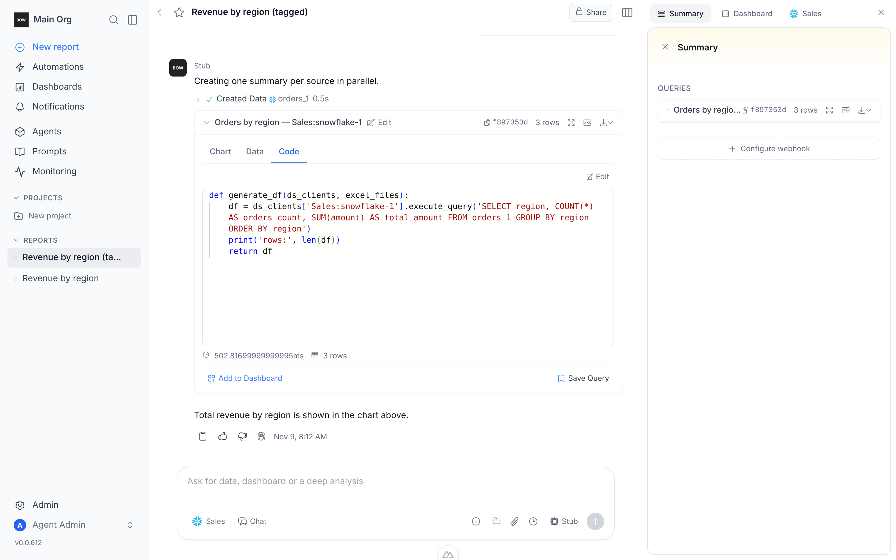
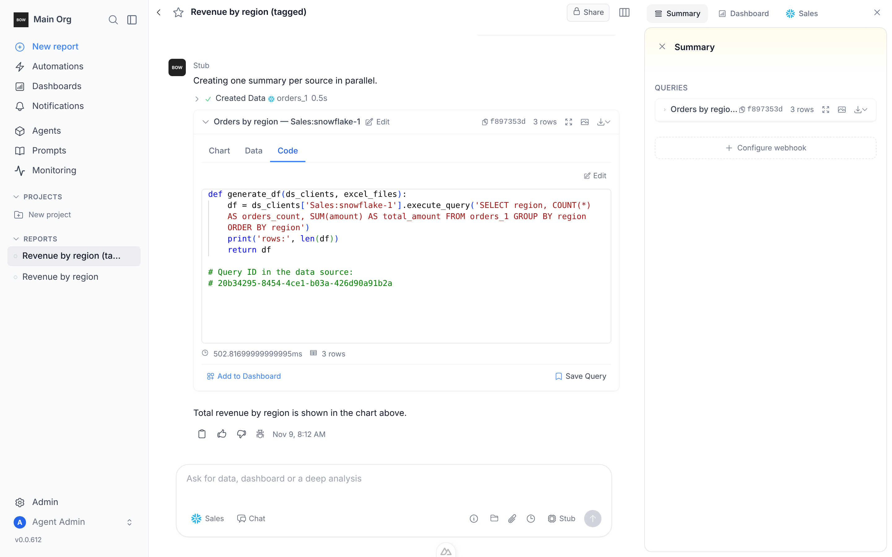
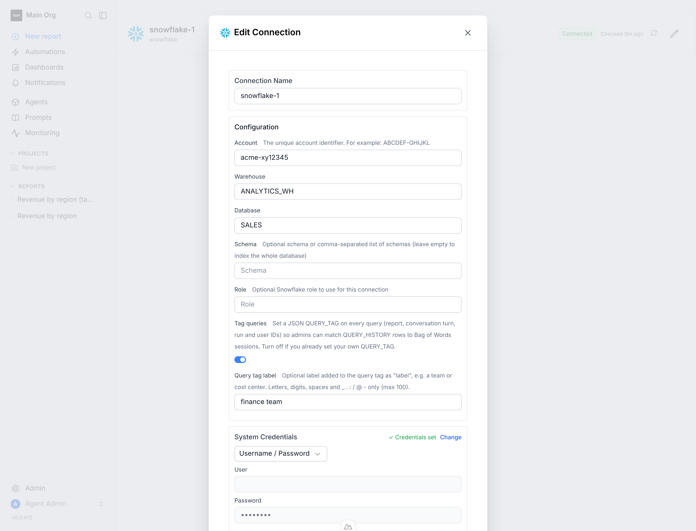

# Feedback Loop — "Can we tag BoW queries so Snowflake shows which queries ran and which BoW session ran them?"

Linear: BOW-115. A Snowflake admin reading `QUERY_HISTORY` saw every Bag of
Words query come from one service user, with nothing tying it to a report, a
conversation turn, a refresh or a person. The claim being validated: every
statement BoW sends to Snowflake now carries a JSON `QUERY_TAG` naming its
origin, and BoW keeps Snowflake's query id for each query it ran, so the link
works in both directions.

## What a tagged query looks like

```json
{"app":"bagofwords","source":"agent","org_id":"…","report_id":"…",
 "completion_id":"…","agent_execution_id":"…","connection_id":"…",
 "data_source_id":"…","user_id":"…","ref_id":"…","label":"finance team"}
```

```sql
SELECT query_id, query_text, warehouse_name, total_elapsed_time
FROM snowflake.account_usage.query_history
WHERE PARSE_JSON(query_tag):report_id = '<bow report id>';
```

`source` is the kind of run: `agent`, `agent_eval`, `query_run`,
`query_viewer_run`, `dashboard_filter_run`, `mcp.create_data`,
`mcp.inspect_data`, `artifact`, `step_run`, `entity_run`,
`report_refresh.schedule|view|manual`, `viewer_refresh`,
`dashboard_refresh.<trigger>`, `indexing`, `connection_test`, else `system`.

## Root cause (validated)

There was nothing to find: BoW never told Snowflake anything about a query.

- `backend/app/data_sources/clients/snowflake_client.py` `execute_query` ran
  `pd.read_sql` on a pooled session with no `QUERY_TAG` and dropped the
  driver cursor (and its `sfqid`) inside pandas.
- The pool (`snowflake_engine`, a cached engine) hands the same session to the
  next caller, so any tag would have to be reset on every checkout or it leaks
  onto the next report's queries.
- Agent queries run on threads with no request context: the query wrapper's
  timeout thread (`code_execution.py` `_call_with_timeout`) and, sandboxed,
  the RPC thread (`sandbox/runner.py`). A plain context variable set by the
  agent run never reaches them.
- A fresh session runs the SQLAlchemy dialect's own setup statements before
  any checkout code sees it, so an `ALTER SESSION` at checkout leaves those
  untagged. (Found by Loop A: `PRAGMA read_uncommitted` on the fake.)

## Loop A — deterministic (no Snowflake, no LLM)

`backend/tests/fixtures/fake_snowflake.py` replaces only Snowflake's driver:
per-session `QUERY_TAG` (via `ALTER SESSION` or connect-time
`session_parameters`), a query id per statement on the cursor (`sfqid`), and a
query history recording each statement with its session's tag. Statements run
on SQLite. `SnowflakeClient`, the SQLAlchemy pool, pandas, the query wrapper
and the connection routes all run unchanged.

```bash
cd backend
export BOW_DATABASE_URL=sqlite:///db/app.db TESTING=true
uv run pytest tests/unit/test_snowflake_query_tag.py -q
uv run pytest tests/e2e/test_snowflake_query_tag.py -m e2e --db=sqlite -q
```

Before the change (app code reverted, tests and the new module kept):

```
15 failed, 3 passed     # unit: no tag, no query id, wrapper drops context
5 failed, 1 passed      # e2e: indexing/test probes untagged, bad label accepted
```

The ones that pass on old code are pure tag-assembly checks and the
"tagging off" guard, which untagged code meets trivially.

## Loop B — the real stack, driven through the UI

The real backend, booted with only the Snowflake driver swapped
(`tools/agent/fake_snowflake_backend.py`), the stub LLM
(`tools/agent/stub_llm.py`), and Playwright on the real frontend.

```bash
cd backend
WH=/abs/scratch   # $WH/warehouse.db: SQLite with orders_1(id, customer, region, amount)
BOW_DATABASE_URL=sqlite:///db/app.db BOW_ENCRYPTION_KEY=<fernet> \
WH_DB=$WH/warehouse.db WH_HISTORY=$WH/wh_history.jsonl \
.venv/bin/python ../tools/agent/fake_snowflake_backend.py &
uv run python ../tools/agent/seed_org.py --db-path db/app.db
# POST /api/data_sources {type: snowflake, config: {..., query_tag_label}},
# PUT  /api/data_sources/<id>/update_tables_status {activate: [orders_1]}
STUB_SOURCES_FILE=$WH/stub_sources.json STUB_PHASES=inspect,create \
.venv/bin/python ../tools/agent/stub_llm.py &
uv run python ../tools/agent/setup_stub_llm.py
cd ../frontend && yarn dev   # then sign in, open a report on the agent,
                             # ask "What is total revenue by region?"
```

Observed (warehouse history vs BoW's own rows):

```
total statements: 19 | untagged: 0
this report's statements: 4
  PRAGMA read_uncommitted        | src agent | completion 82342a95 | run f7391ff4
  SELECT region, COUNT(*) ...    | src agent | completion 82342a95 | run f7391ff4
  ...
agent_executions: [('f7391ff4', '82342a95')]
tools: [('inspect_data', 'success'), ('create_data', 'success')]
```

The tag's `completion_id` and `agent_execution_id` are the run's own rows;
indexing and connection checks from creating the connection are tagged
`indexing` / `connection_test` with the org and connection ids.

Back the other way, the Code tab of the created data shows the Snowflake
query id. It matched the warehouse row (`20b34295-…`) in the first run:

| Before | After |
|---|---|
|  |  |

Connection form: 

## The fix

- `backend/app/data_sources/query_tag.py` (new): assembles the tag from the
  run's usage attribution, `query_tag_defaults(...)` (fills gaps, so an outer
  entry point like a scheduled refresh keeps its `source`) and
  `query_tag_scope(...)` (wins, e.g. the step being run). Values are limited
  to `[A-Za-z0-9 _.:/@-]` (≤100 chars), so no prompt text or quotes reach
  Snowflake. The JSON is trimmed to Snowflake's 2,000-char limit by dropping
  low-priority keys.
- `snowflake_client.py`: new sessions open with `session_parameters`
  `QUERY_TAG` (`do_connect` hook); each checkout re-sets the tag only when it
  changed (`ALTER SESSION`, at most once per run per pooled session); the
  query id is read from the cursor with an `after_cursor_execute` hook and
  put on the result (`df.attrs`) or on the exception. Hooks and ALTER are best
  effort: a failure never blocks the query. Config: `query_tag_enabled`
  (default on) and `query_tag_label`.
- `code_execution.py`: the query wrapper snapshots the tag when built and
  re-applies it on its query thread; each timing row gets `source_query_id`.
- Entry points tagged: agent run (`agent_v2.py`), step runs, report refresh
  (by trigger), viewer refresh, dashboard refresh, entity runs, indexing,
  connection tests (`step_service`, `report_service`, `dashboard_refresh`,
  `entity_service`, `connection_service`, `data_source_service`,
  `clients/base.py`). Query reruns, dashboard filter runs, MCP and artifact
  runs get their `source` from their existing metering context.
- A bad label is rejected on create, edit and "Test connection".
- Frontend: the Code tab shows "Query ID in the data source" (all 10 locales).

## What this proves / regression notes

- Every statement, including a fresh session's driver setup, is tagged. A
  pooled session never carries the previous run's tag, and tagging can be
  turned off per connection.
- Mutation checks: making the tag stick per session, dropping the thread
  re-apply, or removing the query-id hook each turn specific tests red.
- Full `tests/unit`: 204 pre-existing failures reproduce identically with this
  change stashed (missing `libodbc`, CA-bundle path asserts, Babel compiler,
  SharePoint/OBO env). One real regression found and fixed:
  `test_discovery_progress_contract` mocks the engine with `MagicMock`, which
  can't take event hooks; instrumentation is now best effort.
- The stub LLM counted a marker current prompts no longer contain, so it
  looped on its first tool. It now also counts `role="tool"` messages.
- Not covered: a live Snowflake account (no credentials in the sandbox), and
  the real LLM (the sandbox key had no credit). Both are boundaries; the
  driver contract the fake emulates (`session_parameters`, `ALTER SESSION SET
  QUERY_TAG`, `cursor.sfqid`, `ProgrammingError.sfqid`) is snowflake-connector's
  documented API.
