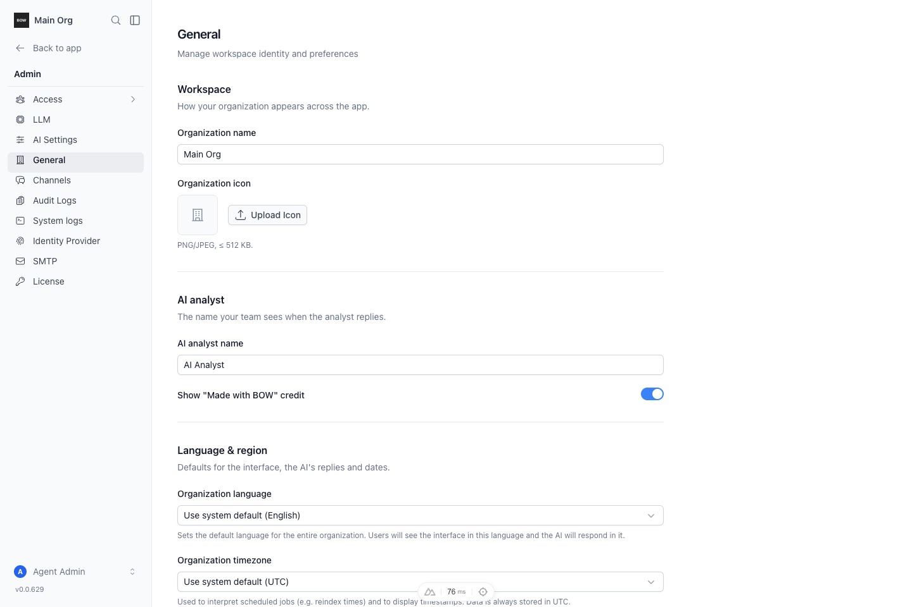
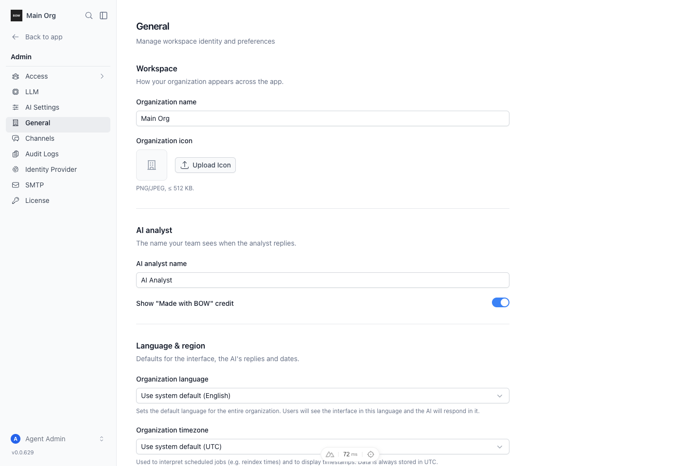

# System logs require an instance superuser

An organization admin could read deployment logs on a single-organization installation. The system log router used the same single-organization exception as license and embedding settings. The navigation also used that exception, and the page checked only the organization permission.

## Reproduce and verify

From the release checkout, run:

```sh
cd backend
BOW_DATABASE_URL=sqlite:///db/app.db TESTING=true uv run pytest --db=sqlite \
  tests/e2e/test_system_logs.py \
  tests/e2e/org_isolation/test_organization_creation_and_instance_admins.py \
  tests/unit/test_app_log_service.py
```

Before the change, the single-organization case in `test_org_admin_cannot_use_system_logs` received HTTP 200 where it expected 403. After the change all 61 tests passed. The API tests cover listing, filtering, status and deletion, including denial for ordinary admins and members.

The system log router now requires a human instance superuser in addition to the existing organization access checks. This requirement applies to all routes on the router. The sidebar and direct page navigation check the session's superuser flag. Other instance settings retain their existing rules.

In Chrome, sign in as an ordinary admin on a single-organization installation and open Settings → General. The System logs link is hidden. Navigating directly to `/settings/system-logs` redirects to the home page. A configured instance superuser with admin access can still open the log viewer.

| Before | After |
|---|---|
|  |  |
