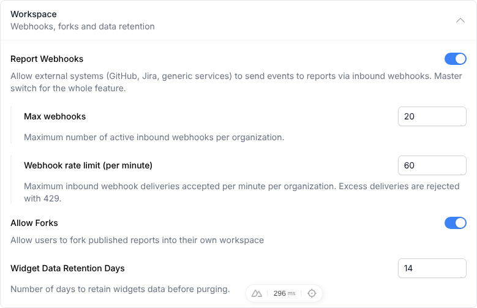
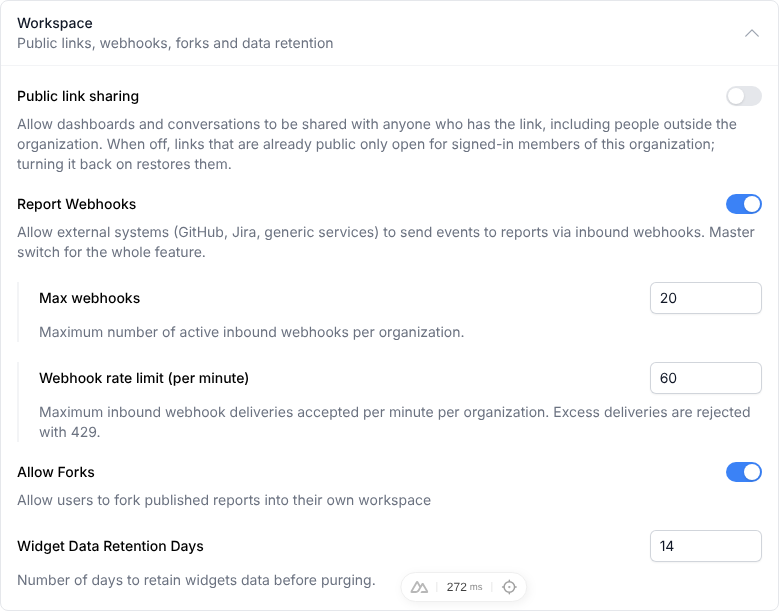
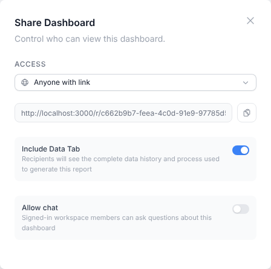
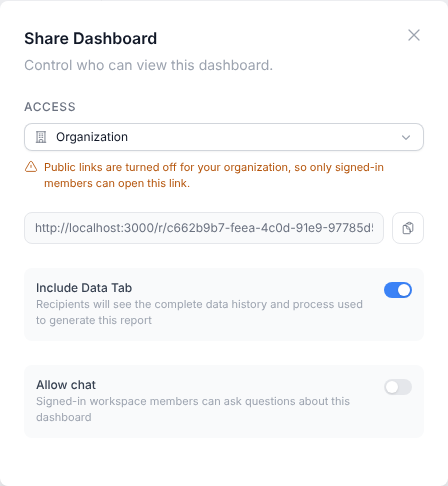
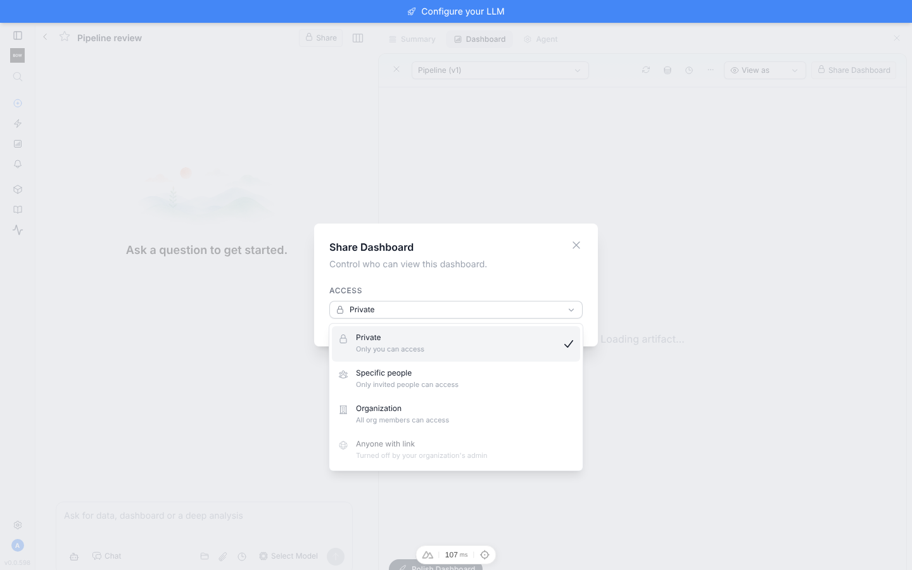
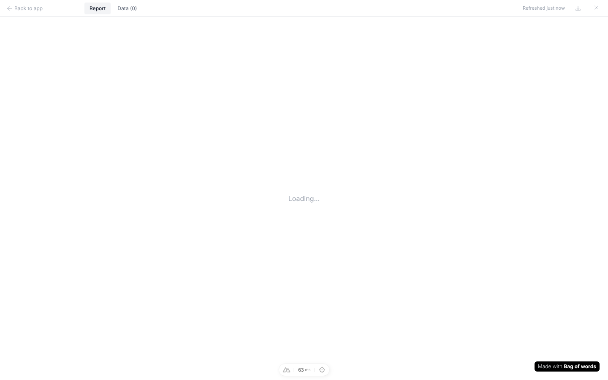
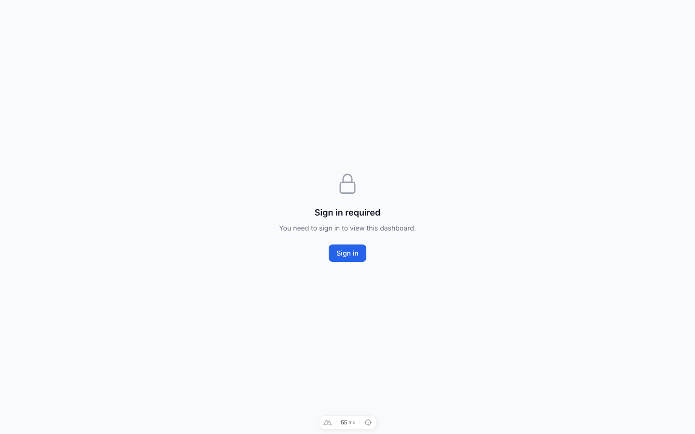
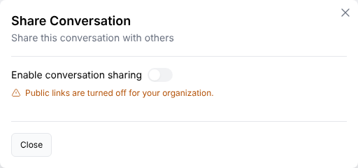
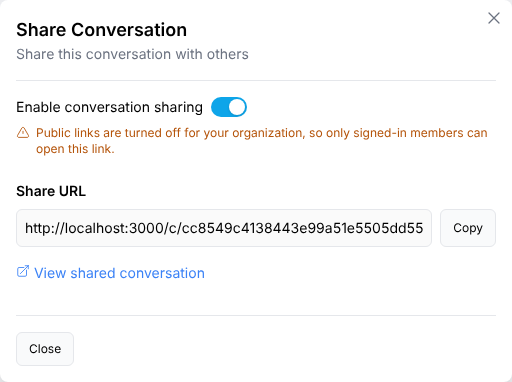
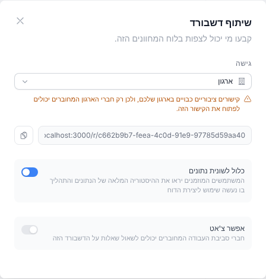

# Public link sharing setting: before / after (PR #1491)

Captured on the live sandbox stack with Playwright. "After" = this branch with the org setting **off**.

| | Before | After (setting off) |
|---|---|---|
| Settings → Workspace |  |  |
| Share dialog, already-public dashboard |  |  |
| Access options |  |  |
| Anonymous visitor opens the public link |  |  |

## Also with the setting off

| Sidebar "Share conversation" (not shared) | Conversation that's already shared |
|---|---|
|  |  |

| Hebrew (RTL) share dialog | Org member opens the link (still allowed) |
|---|---|
|  |  |
